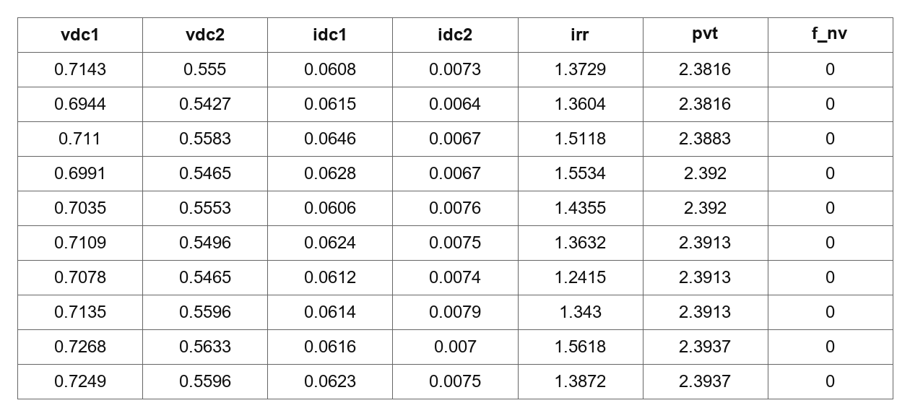

# Resource-Efficient and Explainable PV Anomaly Detection

**[Open the PV Anomaly Detection application](https://pv-anomaly-detection-prince-r-k.vercel.app)** | [Web setup and verification](web/README.md)


**Current milestone: Models, results and a public web inference application.** The completed Assignment 3 preprocessing workflow is retained below. Original archived LR, Random Forest and LightGBM models have been recovered and evaluated without refitting. The original four-channel RF pipeline is available through a public web application and the local CLI.

**Evaluation limitation:** the historical TEST partition was previously inspected. Results are retrospective, not pristine independent generalization estimates. No evaluated configuration met all engineering criteria; RF E4 was selected by the archived validation sensing/performance rule and exceeds separate latency and size targets.

**Task Type: Multiclass Classification.** The [original dataset](https://github.com/clayton-h-costa/pv_fault_dataset), pinned at `e9ed8ad8072dcb3ffc643b0f3604219798708551`, is associated with [Lazzaretti et al. (2020)](https://doi.org/10.3390/s20174688).

| Property | Description |
| --- | --- |
| N × P | 1,373,798 × 7 |
| Predictors | vdc1, vdc2 (V); idc1, idc2 (A); irr (W/m²); pvt (°C) |
| Target | f_nv: 0 normal, 1 short circuit, 2 resistive degradation, 3 open circuit, 4 natural building shade |
| Types | Six continuous measurements and one nominal target; integer labels are not ordinal or continuous |

The [raw CSV](data/raw/pv_fault_dataset.csv), [conversion/source provenance](data/raw/README.md), [variable inventory](phase1_strategy/Variable_Inventory.csv) and [original license](phase1_strategy/PRIMARY_SOURCE_LICENSE.txt) are retained unchanged apart from navigation in the raw-data guide. Voltage/current are source-described DC RMS quantities; module temperature aggregates source probes.



Preview of the raw photovoltaic monitoring dataset. First ten observations in exported source order. All ten have f_nv = 0.

## Data-quality findings

The export has zero conventional missing cells and 1,373,798 complete rows. This does not diagnose MCAR/MAR/MNAR or prove uninterrupted monitoring. The 62 paired irr/pvt zeros remain suspicious observations, not confirmed missing values. One irradiance value is -0.0381 W/m²; the existing quality convention clamps -1 ≤ irr < 0 to zero. Valid negative Celsius observations remain unchanged. No automatic statistical outlier deletion or capping is used.

The irradiance-qualified subset irr ≥ 100 W/m² contains 515,958 observations and reproduces literature class counts exactly. This suggests a possible evaluation-population explanation, but the paper does not explicitly document that filtering operation. Low-irradiance rows are retained rather than deleted to force agreement.

## Preprocessing workflow

Immutable data → schema/quality audit → original ordered partitions → TRAIN-only median/scaling fit → transform validation/test → descriptive diagnostics and output-dimension checks. Paired zeros remain observed. Contingency median imputation and retained-channel indicators are preserved. StandardScaler, native-scale and physical-derived representations are demonstrated without fitting downstream predictors. Robust/MinMax scaling and PCA remain descriptive alternatives; no new transformation or sensor choice is selected.

TRAIN [0,1006129), VALIDATION [1056990,1173967), TEST [1227337,1373798) are retained, with 104,231 separator positions. Sixteen signal-defined blocks are not verified days, sessions or hours. Nominal 1 Hz acquisition, per-second electrical RMS values, one-second environmental averages and the study's 16-day duration do not reconstruct timestamps or uninterrupted spacing. CSV order is source-position order only. The separator remains irr < 100 W/m² for at least 3,600 consecutive source positions, not a verified hour. The reserved partition is not claimed to be historically unseen.

Five TRAIN predictor pairs have |r| ≥ 0.85; five VIF values exceed 10. Dependence does not justify automatic deletion. Nominal-target association uses a proportional 50,000-observation TRAIN MI sample; scatterplots use 20,000 TRAIN positions. Exploratory TRAIN-scaled PCA explains approximately 95.17% with two mathematical components; all six physical inputs are still required to calculate them.

## Deliverables and execution

- [Approved Phase 1 report](phase1_strategy/Phase1_Strategy_Report.pdf) and [audit evidence](phase1_strategy/Supporting_Evidence_Index.md)
- [Executed preprocessing notebook](phase2_implementation/notebooks/Phase2_Preprocessing_Implementation.ipynb)
- [Preprocessing-stage report](phase2_implementation/reports/Assignment3_Phase2.pdf)
- [Eight diagnostics](phase2_implementation/preprocessing_diagnostics/README.md)
- [Preprocessing strategy versus reality](phase2_implementation/compliance/Strategy_vs_Reality.md)
- [Setup and reproduction](phase2_implementation/Reproduction_Guide.md)

After environment setup, run from the root:

```text
python -B phase2_implementation/execute_preprocessing.py
python -B phase2_implementation/verify_submission.py
```

## Structure

```text
data/raw/                         Immutable CSV and provenance
phase1_strategy/                  Original strategy and audit evidence
src/transformers.py               Target-free quality and physical transformations
src/pipeline_builder.py           Pipeline / ColumnTransformer definitions
src/preprocessing/                Preprocessing study and shared constants
phase2_implementation/notebooks/   Executed preprocessing notebook
phase2_implementation/reports/     Preprocessing report and text
phase2_implementation/compliance/  Preprocessing evidence and reflection table
figures/                          Eight 300-DPI diagnostic figures
```

Processed arrays, environments and local review material are excluded. The reflection report records measured stage dimensions, empirical justification and figure-linked decisions; its source and build instructions are included. The analysis makes no deployment-performance, globally minimum-sensing or causal claims. 

## Verified model selection and results

Block-13 VALIDATION only (32,800 observations):

| Model | Physical / mathematical inputs | Macro precision | Macro recall | Macro-F1 | Macro AP |
| --- | --- | --- | --- | --- | --- |
| LR__F6 | 6 / 12 | 0.872022940 | 0.927024112 | 0.893869804 | 0.942431868 |
| RF__E4 | 4 / 8 | 0.955450596 | 0.962811690 | 0.956297122 | 0.989740014 |
| LightGBM__E4 | 4 / 13 | 0.908327034 | 0.866445735 | 0.855657128 | 0.991518322 |

Frozen TEST reporting only (146,461 observations; prior exposure disclosed):

| Model | Physical / mathematical inputs | Macro precision | Macro recall | Macro-F1 | Macro AP |
| --- | --- | --- | --- | --- | --- |
| LR__F6 | 6 / 12 | 0.889885493 | 0.912349415 | 0.898389062 | 0.917422666 |
| RF__E4 | 4 / 8 | 0.926440050 | 0.985651058 | 0.950481150 | 0.976218899 |
| LightGBM__E4 | 4 / 13 | 0.940383125 | 0.896340685 | 0.902137434 | 0.993577665 |

RF E4 is the only one of 21 evaluated channel/family configurations meeting the four archived validation sensing/performance constraints. It requires four electrical channels and eight mathematical inputs. This is not a globally minimum-sensor claim. RF's archived p95 latency is 36.808295 ms and its original artifact is 11.665363312 MiB; both exceed the separate engineering targets. LightGBM's TEST short-circuit recall is .499364676 despite high aggregate hardware-alert recall. Class 4 remains natural building shade, not hardware failure.

[Model-selection report](reports/Model_Selection_and_Deployment.md) ? [Reproduction evidence](reports/model_verification.json) ? [All sensor comparisons](phase2_implementation/stage2/evidence/sensor_ablation_validation.csv) ? [RF confusion matrix](phase2_implementation/stage3/figures/test_confusion_RF__E4.png) ? [Resource comparisons](phase2_implementation/stage3/evidence/final_candidate_comparison.csv)

Raw-channel permutation and native LightGBM Tree SHAP use a fixed balanced validation sample; vdc2 has the largest mean permutation loss for each frozen candidate. These model associations are not causal explanations. Simulated isolated dropout is separate from field reliability. Detailed provenance, class-specific errors, resource measurements and limitations are in the report. Reconstructed noise-study models are not substituted for originals.

## Beginning of deployment ? local CLI

The prototype loads the hash-verified original fitted RF E4 pipeline, validates four voltage/current inputs, and returns a class/label with explicit environmental-shade handling. No true label, timestamp or source index is required. Missing channels are rejected; no calibrated confidence or production readiness is claimed.

Install the exact Python 3.14.7 environment described in [deployment instructions](deployment/README.md), then run from the repository root:

```text
python -B -m src.inference.cli --input deployment/example_input.json
python -B -m unittest discover -s tests -v
python -B -m src.evaluation.verify_recovery
```

[Model provenance](models/rf_e4/provenance.json) ? [Actual example output](deployment/example_output.json) ? [Recovery manifest](reports/Recovery_Manifest.json) ? [Acceptance matrix](reports/Acceptance_Matrix.md)

The Phase 1 PDF, Assignment 3 IEEE report, executed preprocessing notebook, original diagnostic figures and raw data remain unchanged. Only the selected original model is published; other original models, saved arrays, environments and backups remain local. The research application is hosted on Vercel. Prospective external evaluation and production monitoring are not completed.

## Public web application

The [PV Anomaly Detection dashboard](https://pv-anomaly-detection-prince-r-k.vercel.app) accepts four electrical measurements and calls the original fitted RF E4 pipeline through a Python FastAPI endpoint on Vercel. The responsive HTML/CSS/JavaScript interface includes dataset examples, five-class results, validation, loading and error states. Natural building shade is identified as an environmental condition. No confidence percentages or calibrated probabilities are presented.

Anonymous live API and browser checks pass for all five existing examples, including desktop and 390/320-pixel mobile layouts. The original model SHA-256, fitted preprocessing, parameters and scientific results are unchanged. The interpreter allowlist now additionally accepts independently parity-verified Python 3.14.8 (Vercel build) and 3.14.10 (Vercel function); training used 3.14.7.

- [Local execution, architecture and deployment](web/README.md)
- [Production API verification](web/Production_Verification.json) and [browser verification](web/Browser_Verification.json)
- [Runtime compatibility evidence](web/Python31410_Compatibility.json) and [deployment verification summary](web/Verification.json)

The application runs on the Vercel Hobby plan. Hosting the research demonstration does not establish production protection-system reliability, calibration, prospective generalization or operational monitoring.

### Interactive dashboard

The web application now presents measurements, synthetic/dataset scenarios, animated voltage/current comparisons and actual-class explanations in a single desktop screen. Synthetic inputs are clearly labeled, generated independently of the model, and separated from historical observations. Selected scenario intent can differ from the real model output; that difference is shown explicitly. No model probabilities or feature contributions are fabricated. See the [dashboard design and scenario methodology](web/README.md).

[Preview layout verification](web/Redesign_Preview_Verification.json) | [Current production browser verification](web/Browser_Verification.json)
