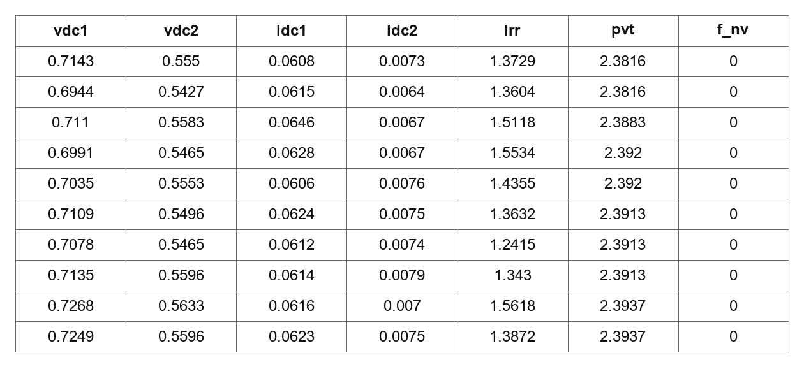

# Resource-Efficient and Explainable AI for Photovoltaic Anomaly Detection Under Sparse Sensing Constraints

Ruganji Prince | Carnegie Mellon University Africa

**Course:** 04-652 Artificial Intelligence System Design  
**Assignment:** Assignment 2: Data Preprocessing  Phase 1  
**Task Type: Multiclass Classification**

This submission contains the raw-data audit and preprocessing/feature-engineering design. Future implementation directories contain structural placeholders. Implementation evaluation is outside this Phase 1 submission and is intended for a later submission after professor feedback.

## Problem statement

The project investigates the minimum sensing and computational configuration that can provide practically useful PV anomaly detection under sparse-sensing and resource constraints. Fewer acquired measurements can reduce sensing and maintenance requirements, while lightweight models may reduce computing demands. The planned study compares predictive quality with physical sensing requirements and computational resources; it does not assume that the smallest feature set is adequate.

SDG 7 reliable, affordable energy motivates the application. Evidence comes from one experimental Brazilian plant and does not establish Rwanda/Sub-Saharan African field generalization or maintenance effectiveness.

## Phase 1 report

The official report is the [final approved strategy PDF](phase1_strategy/Phase1_Strategy_Report.pdf). It is copied byte-for-byte from AISD_Assignment2_Phase1.pdf; its scientific content has not been edited. [Report provenance](phase1_strategy/Approved_Report_Provenance.json) records its SHA-256. No corresponding finalized LaTeX source was available; older report drafts are not presented as the source of this PDF.

[Evidence index](phase1_strategy/Supporting_Evidence_Index.md), [decision log](phase1_strategy/Decision_Log.csv), and [Phase 1 rationale guide](phase1_strategy/Decision_Rationale_Guide.md) explain the design and its assumptions.

## Dataset overview

Source: [original author PV Fault Dataset](https://github.com/clayton-h-costa/pv_fault_dataset), pinned commit e9ed8ad8072dcb3ffc643b0f3604219798708551. Associated study: Lazzaretti et al., Sensors 20(17), 4688 (2020), [DOI](https://doi.org/10.3390/s20174688).

| Property | Description |
|----------|-------------|
| Number of observations (N) | 1,373,798 raw observations/source positions |
| Number of variables (P) | 7 total variables: 6 predictors + 1 target |
| Predictors (X) | `vdc1`, `vdc2`, `idc1`, `idc2`, `irr`, `pvt` |
| Target (Y) | `f_nv` |
| Task | Multiclass classification with five operating states |
| Predictor type | Six continuous numerical measurements |
| Predictor storage type | `float64` |
| Target type | Nominal categorical variable |
| Target storage type | `uint8` |
| Timestamp field | Not present in the released dataset |
| Other feature types | No discrete-count, ordinal, datetime, text, or categorical predictor fields are exported |

| Variable | Role | Data type | Physical meaning | Unit |
|----------|------|-----------|------------------|------|
| `vdc1` | Predictor | Continuous (`float64`) | DC RMS voltage measured for PV string 1 | V |
| `vdc2` | Predictor | Continuous (`float64`) | DC RMS voltage measured for PV string 2 | V |
| `idc1` | Predictor | Continuous (`float64`) | DC RMS current measured for PV string 1 | A |
| `idc2` | Predictor | Continuous (`float64`) | DC RMS current measured for PV string 2 | A |
| `irr` | Predictor | Continuous (`float64`) | Plane-of-array solar irradiance | W/m² |
| `pvt` | Predictor | Continuous (`float64`) | Reported PV module temperature, aggregated from four source probes | °C |
| `f_nv` | Target | Nominal (`uint8`) | PV operating-state/fault label | Unitless |

| `f_nv` code | Operating state | Interpretation |
|------------:|-----------------|----------------|
| 0 | Normal | Normal PV system operation |
| 1 | Short circuit | Short-circuit fault condition |
| 2 | Resistive degradation | Resistive-degradation fault condition |
| 3 | Open circuit | Open-circuit fault condition |
| 4 | Building shade | Natural building-shading condition |

`f_nv` is numerically encoded for storage, but the values 0–4 represent nominal class labels rather than an ordinal or continuous scale.

The ten observations shown in the raw-data preview have `f_nv = 0`; therefore, they are labeled as normal operating observations.

The two MAT files provide complementary columns at corresponding source positions. Equal lengths/source context support provisional alignment; no timestamps or verified day/session identifiers are recovered. Electrical equipment conditions were induced; shade occurred naturally. Temperature aggregates source probes, so numerical channel count does not directly equal device count.

The intentionally published [raw CSV](data/raw/pv_fault_dataset.csv) contains every original measurement and label without cleaning or scaling. [CSV provenance](data/raw/README.md) identifies the format conversion and license. Original MAT/candidate files remain ignored and can be retrieved at the pinned source commit.

## Raw data preview

Preview of the raw photovoltaic monitoring dataset. First ten observations in exported source order.

### Temporal data clarification

Measurements were acquired at a nominal 1 Hz cadence according to the [associated study](https://doi.org/10.3390/s20174688), Sections 3, 3.2 and 4.1. Electrical RMS quantities were calculated every second; irradiance and module-temperature values were supplied as one-second averages. The study describes a 16-day experiment. The released MAT files and exported CSV, however, do not contain an explicit timestamp variable. The CSV preserves the original MAT-vector ordering, but absolute timestamps and uninterrupted one-second spacing across the complete exported sequence cannot be reconstructed from the released data. Consequently, this project treats row order as source-position order rather than assigning synthetic timestamps.

The documented acquisition cadence and experiment duration do not establish that the 16 signal-defined operating blocks correspond to days, sessions or hours. The separator definition remains irradiance `irr < 100 W/m²` for at least 3,600 consecutive source positions; these positions are not interpreted as one hour.

## Phase 1 audit findings and strategy

All seven columns contain zero conventional missing cells: 0/9,616,586 cells (0%). All 1,373,798 observed rows are complete; none is incomplete. This does not establish uninterrupted monitoring because omitted time intervals cannot be reconstructed.

There are 62 suspicious paired irr=0/pvt=0 positions, in runs of 1/32/29. They remain quality annotations rather than confirmed missingness. Zero exported NaNs provides no empirical diagnosis of MCAR, MAR or MNAR. One irradiance measurement is -0.0381 W/m²; its proposed near-zero clamp is an engineering convention. Negative Celsius readings remain valid.

Normal accounts for 84.6508% of raw positions; equipment states are rare. [Class counts](phase1_strategy/Class_Distribution.csv) motivate macro-F1, classwise precision/recall and PR measures. Training-derived balanced/unweighted variants are planned; validation/test data will not be rebalanced.

The contingency imputer will use training medians and retained-channel availability indicators for eligible short unavailability, with abstention considered for sustained/multichannel loss. Training mean/median/skewness evidence supports this conservative choice while acknowledging that a low-light median may be inappropriate during generation.

Training IQR fences are Q1 - 1.5 IQR and Q3 + 1.5 IQR. A training-based |Z| > 3 is an additional distribution-qualified screen. Existing screens flag zero values; unusual fault readings are retained instead of automatically capped/deleted.

Training Pearson |r| >= 0.85 flags five predictor pairs; five VIF values exceed 10. The strategy retains the six physical reference channels, uses linear regularization, and plans later tests of named physical removals rather than equating correlation with engineering redundancy.

Continuous-predictor/nominal-target association will use training-only mutual information, with descriptive one-versus-rest point-biserial effects and explicit dependence limitations. No categorical predictor encoding is needed. The target codes remain nominal labels.

Logistic Regression will use training-fitted StandardScaler; Random Forest will retain native numerical scale. RobustScaler/MinMax and nonnegative log1p are sensitivity alternatives. Exploratory training-only PCA will examine variance/loadings, but fewer components do not imply fewer physical sensors.

## Planned split and leakage prevention

Sixteen signal-defined operating blocks arise from irr <100 W/m² stretches of at least 3,600 source positions. These positions are not interpreted as seconds, hours or verified days/sessions. Strong neighboring-row dependence makes naive random row splitting inappropriate.

| Partition | Blocks | Interval [start,end) | N | Retained-row % |
| --- | --- | --- | --- | --- |
| Training | 1–12 | [0,1006129) | 1,006,129 | 79.2498 |
| Validation | 13–14 | [1056990,1173967) | 116,977 | 9.2139 |
| Test | 15–16 | [1227337,1373798) | 146,461 | 11.5363 |

Two separator regions withhold 104,231 positions; retained N is 1,269,567. The 12/2/2 block percentages are 75/12.5/12.5%, distinct from row percentages.

Validation block 13 [1056990,1089790), N=32,800, is designated for model/settings selection. Block 14 [1140571,1173967), N=33,396, is designated for equipment-threshold selection. Test blocks are isolated from those decisions in the planned architecture. [Split manifest](phase1_strategy/Phase1_Split_Manifest.json) supplies the exact bounds/class supports.

Planned flow: immutable raw data → schema/partition → fit preprocessing/model on training only → transform validation/test → validation-only settings/threshold decisions → fixed held-out evaluation.

All learned medians, scaling, distribution bounds, selection/PCA and class weights will use training only. The target, acquisition_index, block IDs, future readings and post-event information are excluded from model predictors. A Pipeline/ColumnTransformer will own learned transformations.

## Planned sensor ablation experiment

F6, E5, E4, C3, C2, S4 and S2 are planned for comparison on identical partitions using engineering rules, Logistic Regression and a bounded Random Forest. A removed channel must not be reconstructed from another feature using that removed measurement. The planned comparison examines macro-F1 degradation alongside absolute fault recall/false alarms, acquisition requirements, latency, footprint and availability. The official report records the proposed budgets and success criteria; this submission reports no implementation outcomes.

## Setup and inspection from the repository root

Verified package versions are pinned for Python 3.14.7. Setup requires a working Python installation:

~~~powershell
python -m venv .venv
.venv\Scripts\python.exe -m pip install -r requirements-lock.txt
.venv\Scripts\python.exe -B -X utf8 phase1_strategy\verify_phase1.py
~~~

The verifier reads the approved PDF, stored audit CSV/JSON, split manifest and raw CSV. It checks counts/types, consistency, placeholders, links and secret/path patterns. It does not fit a model, regenerate a report or alter scientific evidence. The supplied verification metadata was produced during snapshot preparation.

## Optional independent audit reproduction

To reproduce the original audit without overwriting the official PDF or stored evidence:

~~~powershell
.venv\Scripts\python.exe -B -X utf8 phase1_strategy\reproduce_audit.py
~~~

This creates an unused ignored .cache/phase1_audit_reproduction directory, downloads hash-pinned source MAT files there, and runs copies of the original Phase 1 audit scripts there. It compares key totals/group bounds against the stored audit. Network access is required for absent sources. No production classifier is fitted. Report-generation scripts are intentionally excluded to prevent overwriting the approved PDF.

## Repository structure and publication status

The root contains README/dependencies/ignore rules; data/raw contains the approved uncleaned CSV and provenance; phase1_strategy contains the report and audit/design evidence. data/processed and phase2_implementation/notebooks contain only .gitkeep; figures contains the raw-data preview and .gitkeep. src contains three planning/docstring placeholders.

