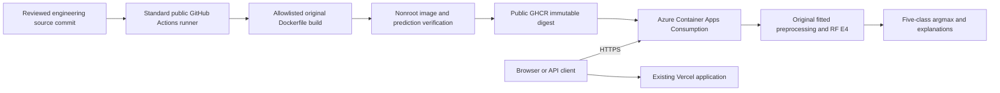

# Azure inference architecture

This engineering extension reuses the original RF E4 inference runtime and four-step frontend. Model training, preprocessing fitting, threshold selection and scientific results are outside deployment scope.

The approved Azure allocation is one Linux container with 0.5 vCPU, 1 GiB, minimum zero and maximum one replica. The environment explicitly uses WorkloadProfiles mode with only the Consumption profile. Public ingress terminates HTTPS and forwards to Uvicorn on port 8000. No database, GPU, paid registry, dedicated workload, private endpoint, custom virtual network or persistent Log Analytics workspace is required.

The original model remains `models/rf_e4/model.pkl` with SHA-256 `55b0e94d86f548b14444182de977f521e4ab79e7d92b339190b45ed23bd5ccdb`. The fitted artifact includes preprocessing state. Four physical inputs are required: vdc1/vdc2 in V and idc1/idc2 in A. Source-described DC RMS terminology is retained. The fitted classifier has eight mathematical inputs after availability indicators; this does not imply eight physical sensors. The application rejects missing, extra, negative and nonfinite inputs under its existing contract. Observed training-range warnings are not certified equipment limits.

Startup and readiness HTTP probes use `/api/health`, which verifies the original model before returning ready. The TCP liveness probe checks the listening process. Startup grace allows model initialization. The model is cached in process memory. At most two inference operations execute per process; this is not distributed per-user/IP rate limiting. Existing body and inference response deadlines remain five and fifteen seconds respectively; an expired response does not forcibly kill the worker thread.

Inference uses the original multiclass argmax. Class 4 is natural building shade, an environmental condition rather than hardware failure. The archived hardware-alert threshold and experimental probability calibration are not deployed. No confidence or probability endpoint is added.

The GHCR pull is public and requires no user registry credentials. Azure operations use the authenticated local CLI; the container and browser contain no Azure credentials. The publication workflow uses an ephemeral package-write GitHub token only after image verification. No Azure service principal or long-lived CI secret is required for this manual deployment procedure.

Scale-to-zero trades intermittent first-request delay against replica activity. Replica counts and platform state must be observed before attributing latency to a scale-from-zero event. A slow request or `X-PV-Initialized` alone is insufficient evidence of a full platform cold start. Server timings are wall-clock application components, not billed CPU measurements.

Historical TEST reference observations establish serving consistency only. They do not restore test independence or demonstrate field generalization, sensor reliability or industrial safety.
