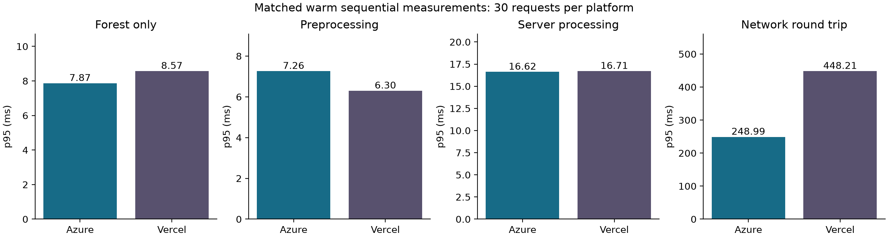
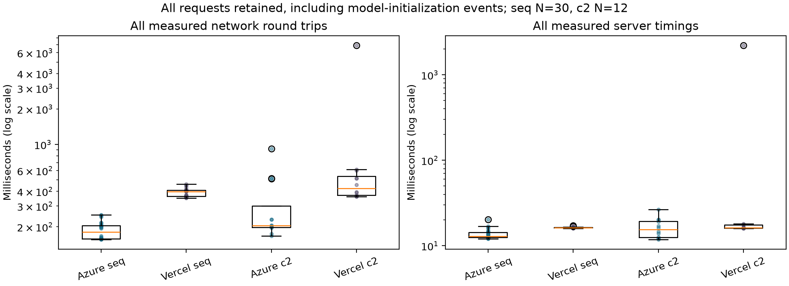
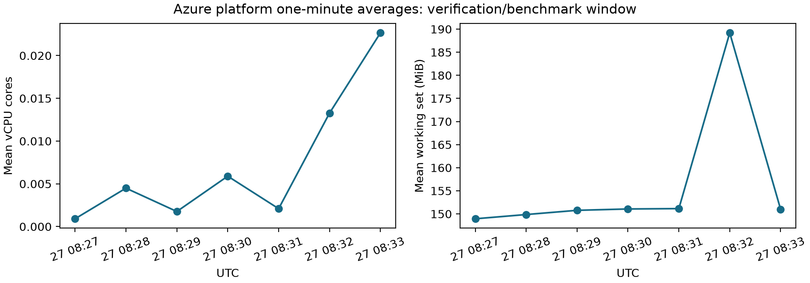

# Azure and Vercel cloud comparison

Engineering extension measured on 2026-11-27. [Azure application](https://pv-anomaly-detection.wittygrass-37610045.francecentral.azurecontainerapps.io) and [existing Vercel application](https://pv-anomaly-detection-prince-r-k.vercel.app) serve the same original RF E4 model and frontend. The protected submission tag remains unchanged. These are serving-system measurements, not new classifier accuracy or independent generalization results.

## Matched protocol

The [benchmark implementation](benchmark.py) used the same Windows/Python 3.14.10 client, httpx client configuration and network connection, identical fixed normal-case payloads, three warmups per platform, alternating platform order for 30 sequential requests, and 12 additional requests at concurrency two per platform. Physical client egress was not geolocated; the Africa/Johannesburg timezone is not evidence of a Rwanda measurement location. [Raw CSV](live/Latency_Benchmark.csv) and [full summary](live/Latency_Summary.json) preserve all attempts and initialization events. All 84 measured requests succeeded with correct predictions; the six warmups are recorded separately.

| Metric | Vercel | Azure |
| --- | --- | --- |
| Hosting | Existing FastAPI Python serverless functions, Hobby plan | Container Apps, WorkloadProfiles environment with Consumption only |
| Runtime | Health reports Python 3.14.10 | Health and in-container exec report Python 3.14.10 |
| Deployment | Existing Vercel source deployment, not redeployed in this extension | Public GHCR immutable Linux amd64 image |
| Container in production | No; Docker verification is separate | Approved digest in [provenance](Container_Provenance.json) |
| CPU / memory | Not independently measured for this comparison | 0.5 vCPU / 1 GiB allocated |
| Scaling | Multiple model-instance IDs observed; no control-plane zero-state proof | Configured minimum 0 / maximum 1; replica observations recorded separately |
| Forest-only p95 | 8.57 ms | 7.87 ms |
| Preprocessing p95 | 6.30 ms | 7.26 ms |
| Server-processing p95 | 16.71 ms | 16.62 ms |
| Network p95, warm sequential | 448.21 ms | 248.99 ms |
| Measured success | 42/42 | 42/42 |
| Original model size | 12,232,020 bytes / 11.665363 MiB | Same original artifact |
| Fixed-class parity | Five cases matched local CLI | Five cases matched local CLI and Vercel |
| Numerical probability parity | Public probabilities intentionally not exposed | Actual Azure exec: 200 TRAIN rows, maximum difference 3.33e-16; five fixed rows vs local 2.22e-16 |
| Costs | Hobby verified by read-only team API; actual project usage charges not retrieved | Explicit scenarios and delayed ActualCost query in [cost analysis](Cost_Analysis.md) |
| Safeguards | Existing schema, deadlines, bounded per-process inference and CSP | Same unchanged runtime safeguards, managed HTTPS and verified nonroot image |

## Latency interpretation

Azure warm sequential network p50/p95/p99 was 180.28/248.99/251.53 ms; Vercel was 398.68/448.21/457.52 ms. Means were 187.57 and 390.70 ms, with sample standard deviations 32.48 and 31.14 ms respectively. Minima, maxima and all server-component statistics remain in the summary.

For concurrency two, all-request network p95 was 697.47 ms for Azure and 3,443.36 ms for Vercel (12 requests each). One Vercel request loaded a model cache in 2,156.55 ms and took 6,901.23 ms end to end. Removing that explicitly marked initialization event only for the separately labeled warm subset leaves Vercel warm N=11, network p95 606.69 ms; Azure warm N=12, p95 697.47 ms. The all-request result retains the event. A Vercel warmup also initialized a model in 2,061.94 ms. Neither event establishes full platform cold-start time.

The first Azure health request took 12,147.96 ms while the revision activated; that readiness observation was not a controlled zero-state experiment. A subsequent [natural zero-to-running experiment](live/Scale_From_Zero.json) verified zero replicas before a prediction and one new ready replica afterward. The first prediction succeeded in **56,941.93 ms**, followed by a request in705.50 ms. Its server timing was41.82 ms, with model-init-in-request0 because readiness probes can initialize the cache. This single observed activation combines network/TLS, ingress waiting, scheduling and startup/readiness; it does not isolate full platform cold-start components. It demonstrates a substantial practical first-access delay, close to the unchanged frontend's60-second prediction timeout. Open the health/application URL and wait for Model ready before the professor demonstration; no guaranteed cold-start bound or scheduled keepalive is claimed.

Server timing covers application processing until response headers; network timing additionally includes connection/queue/transport effects. Component quantiles do not add to a total quantile. The original complete-inference target remains 10 ms: sequential server p95 exceeded that target on both platforms. The unchanged model also remains above the original 10 MiB target. No target was relaxed.

Only a small, single-client run was measured. Thirty sequential observations and twelve concurrency-two observations do not establish stable p99, availability SLAs, geographically general performance or a universally superior platform. Azure reduced round-trip latency for this client/run; server timings were similar, and warm concurrency-two results differ from the all-request comparison. The historical Vercel benchmark remains unchanged and is not substituted for this fresh matched run.

## Resource observations

The [post-benchmark Azure platform receipt](after_benchmark/Resource_Usage.json) contains seven one-minute observations at collection time. The largest reported minute-average CPU value was 0.022655 vCPU, and the largest minute-average working set was 189.19 MiB. These averages include verification/browser/admin-exec activity as well as benchmarking; they are not instantaneous peaks, isolated model CPU, or billed usage. The earlier constrained Docker snapshot was 151.1 MiB. No memory-allocation increase was required. Missing or delayed metric points are not filled with fabricated values.

The original dataset, scientific findings, selected model, fitted preprocessing, historical TEST limitations and class-4 environmental interpretation remain unchanged. See [security](Security_Verification.md), [costs](Cost_Analysis.md), [architecture](Architecture.md) and [acceptance matrix](Acceptance_Matrix.md).
