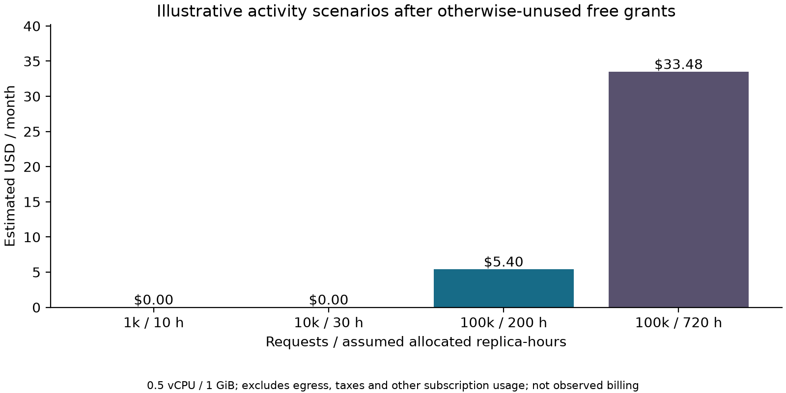

# Azure cost analysis

These are explicit usage scenarios and delayed billing observations, not a zero-cost guarantee. The subscription remains Azure for Students with spending limit On. The USD100 starting balance is user-confirmed; remaining student credit was not independently retrieved. No subscription upgrade, paid support, dedicated compute, paid registry, custom networking or persistent Log Analytics workspace was provisioned.

## Current rate evidence

The [pricing refresh](Provisioning_Pricing_Refresh.json) queried Microsoft's retail API for France Central immediately before provisioning. Active rates were USD0.000024/vCPU-second and USD0.000003/GiB-second, plus USD0.40/million HTTP requests beyond free grants. Monthly grants are 180,000 vCPU-seconds, 360,000 GiB-seconds and two million HTTP requests, shared per subscription. At 0.5 vCPU/1 GiB, otherwise-unused compute grants cover approximately 100 allocated replica-hours. Compute is not charged while replicas are zero. Startup and idle cooldown can consume replica time.

Formula for the explicit all-active-rate illustration:

```text
CPU charge = max(0, 0.5 * allocated_seconds - 180000) * 0.000024
Memory charge = max(0, allocated_seconds - 360000) * 0.000003
Request charge = max(0, monthly_requests - 2000000) / 1000000 * 0.40
```

This conservative activity model uses allocated replica time; it does not multiply HTTP latency by request counts or equate wall-clock timings with billed CPU. Actual meters/idle eligibility and other subscription usage can change costs.

## Monthly scenarios

| Requests | Assumed sessions/month | Assumed allocated activity | Compute + requests after unused grants |
| ---: | ---: | ---: | ---: |
| 1,000 | 30 | 10 hours | USD0.00 |
| 10,000 | 90 | 30 hours | USD0.00 |
| 100,000 | 600 | 200 hours | USD5.40 |
| 100,000, continuously active 30-day illustration | Continuous | 720 hours | USD33.48 |

Each noncontinuous session assumes twenty allocated minutes inclusive of startup, requests, probes and cooldown, with zero replicas between nonoverlapping windows. These activity windows are hypothetical, not predicted from the benchmark. The 100,000-request scenario consumes the full grants plus billable activity. Identical request totals can cost differently with different arrival patterns. The [calculator](costs.py) and [machine-readable assumptions](Monthly_Cost_Scenarios.json) make this explicit.



## Observed costs and credit

The resource-group month-to-date ActualCost query succeeded but returned **no cost rows** in both the [initial receipt](live/Billing_Observation.json) and [post-benchmark receipt](after_benchmark/Billing_Observation.json). This is delayed/unavailable charge information, not a verified zero invoice. Free-grant usage may not appear as a charge. Student-credit consumption and the remaining balance therefore remain unverified. Recheck Cost Management and the Sponsorships balance before and after evaluation.

Public GHCR storage/bandwidth and standard public-repository GitHub Actions runners are currently free under published policies. Persistent log ingestion is disabled; live log availability/retention is limited. Internet egress, taxes/currency conversion and unrelated subscription consumption are excluded from the estimates. Azure advertises a shared first 100 GB internet egress allowance, but actual transfer/grant availability was not independently measured; no zero-network-cost claim is made. Private endpoints and planned-maintenance features were not enabled because extra management charges can apply.

Vercel's existing team was verified as Hobby by a read-only API call; the [sanitized plan observation](Vercel_Plan_Observation.json) retains the result. Published included usage lists four active CPU-hours and 360 GB-hours of provisioned memory; request count alone cannot establish whether those limits are sufficient. No Vercel upgrade or paid feature was enabled. The historical Vercel cost scenarios remain unchanged; actual billable CPU and project charges were not retrieved for this matched run.

Budget alerts, if later requested, notify rather than enforce a hard cap. No alert resource was created. The application remains available for evaluation; cleanup/interruption commands in the [resource-control guide](Cleanup_Guide.md) require separate approval.

Sources: [Microsoft Container Apps billing](https://learn.microsoft.com/en-us/azure/container-apps/billing), [regional pricing](https://azure.microsoft.com/en-us/pricing/details/container-apps/), [bandwidth](https://azure.microsoft.com/en-us/pricing/details/bandwidth/), [GitHub Packages](https://docs.github.com/en/billing/concepts/product-billing/github-packages), [standard runner policy](https://docs.github.com/en/actions/how-tos/write-workflows/choose-where-workflows-run/choose-the-runner-for-a-job), [Vercel Hobby](https://vercel.com/docs/plans/hobby).
