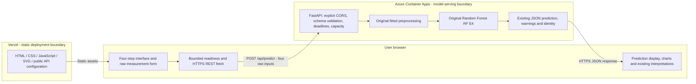

# Decoupled frontend and model-serving architecture

The [verified production frontend](https://pv-anomaly-detection-prince-r-k.vercel.app) is a static-only Vercel deployment (deployment `dpl_H77uanaDrGutfBv5vJkb5825u3Gi`); the [original preview](https://pv-anomaly-detection-pbyhom77a-prince-r-k.vercel.app) is retained. The original fitted RF E4 model executes independently on [Azure Container Apps](https://pv-anomaly-detection.wittygrass-37610045.francecentral.azurecontainerapps.io). JavaScript sends the four raw electrical measurements directly from the browser to Azure over HTTPS. Vercel serves assets; it does not proxy or compute these predictions.

The static build has nine output files: one routing configuration and eight served assets. No model, fitted preprocessing artifact, Python runtime, serverless inference function, raw CSV or scientific report is included. The model SHA in frontend health validation is public identity metadata, not a trained artifact. Source build tooling remains in the repository but is excluded from the deployed static output.

The [actual Vercel output inventory](Frontend_Deployment_Verification.json) and [browser network records](Browser_Network_Verification.json) verify the deployment boundary. `/api/predict` on the production frontend returns 404 (as it has no inference function). Every observed application API request reaches the Azure hostname. Blocking Azure produces a controlled error and clears prediction presentation; no local substitute class is generated.

Azure uses the existing app/environment/resource group, Consumption profile,0.5vCPU/1GiB,min0/max1,HTTPS ingress to8000. The CORS adapter wraps the unchanged inference application. [Container verification](Backend_Container_Verification.json) and [the original Docker verification](Original_Docker_Verification.json) pass with the original model. The deployed CORS image is pinned by digest in [revision configuration](Azure_Revision_Configuration.json). The prior revision/image remain available for rollback.

Existing class-specific explanatory text is presentation logic selected from the actual returned class. Azure computes the model prediction, category and range warnings. The interface does not claim fresh SHAP, calibrated confidence, causal explanation or a confirmed physical diagnosis. Class4 remains natural building shade, an environmental condition. Charts depict supplied inputs and selected intent, not measured time series or alternative predictions.

The original dataset, split, trained weights, fitted transformations, scientific findings and submission tag remain unchanged. Production was switched to the verified static-only deployment and independently checked; the legacy server-side deployment `dpl_D24pfF7JJsBL5PRSy8VRQFAeXcpU` is preserved for rollback. GitHub `main` includes the decoupled engineering changes.
