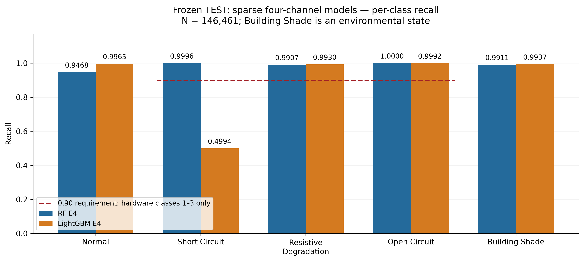
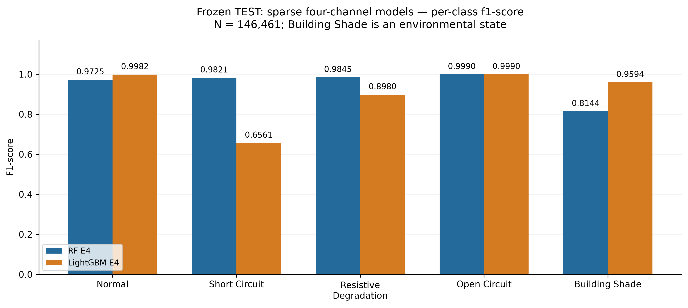
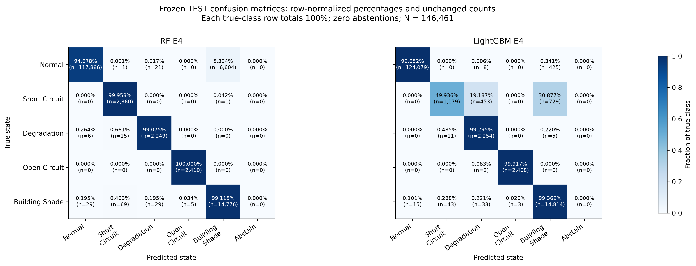
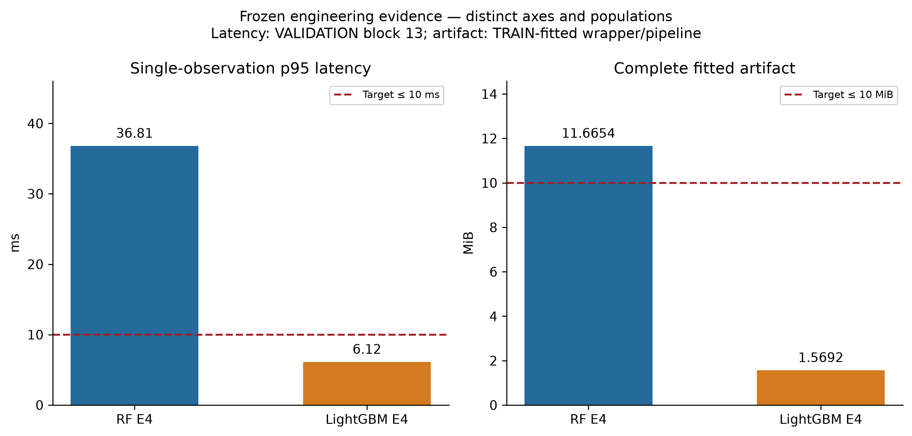

# RF E4 versus LightGBM E4: frozen class-by-class comparison

Source commit: `34ab15ed18abb29defc0f30baa284f189fc05aef`. Both candidates use E4 = [vdc1, vdc2, idc1, idc2], four physical channels. RF has 8 mathematical inputs; LightGBM has 13 because approved derivatives and availability indicators do not add measured channels. This comparison uses frozen TEST evidence, with explicitly labeled frozen VALIDATION/TRAIN resource evidence. No report is modified.

## Class-level metrics

All metrics below are observation-level TEST values. AP is frozen one-vs-rest average precision, not trapezoidal PR integration. Precision/recall/F1/AP are displayed to four decimals; CSV files retain full precision. Supports are identical between models, not additive across models. The recall criterion applies only to hardware classes H = {1,2,3}. Building Shade is environmental.

| Class | Model | Precision | Recall | F1 | AP | Support | Hardware recall ≥0.90? |
| --- | --- | --- | --- | --- | --- | --- | --- |
| 0 — Normal | RF E4 | 0.9997 | 0.9468 | 0.9725 | 0.9986 | 124,512 | N/A |
| 0 — Normal | LightGBM E4 | 0.9999 | 0.9965 | 0.9982 | 1.0000 | 124,512 | N/A |
| 1 — Short Circuit | RF E4 | 0.9652 | 0.9996 | 0.9821 | 0.9812 | 2,361 | PASS |
| 1 — Short Circuit | LightGBM E4 | 0.9562 | 0.4994 | 0.6561 | 0.9764 | 2,361 | FAIL |
| 2 — Resistive Degradation | RF E4 | 0.9783 | 0.9907 | 0.9845 | 0.9954 | 2,270 | PASS |
| 2 — Resistive Degradation | LightGBM E4 | 0.8196 | 0.9930 | 0.8980 | 0.9952 | 2,270 | PASS |
| 3 — Open Circuit | RF E4 | 0.9979 | 1.0000 | 0.9990 | 1.0000 | 2,410 | PASS |
| 3 — Open Circuit | LightGBM E4 | 0.9988 | 0.9992 | 0.9990 | 1.0000 | 2,410 | PASS |
| 4 — Building Shade | RF E4 | 0.6911 | 0.9911 | 0.8144 | 0.9059 | 14,908 | N/A |
| 4 — Building Shade | LightGBM E4 | 0.9274 | 0.9937 | 0.9594 | 0.9963 | 14,908 | N/A |

## Error counts and destinations

FP and FN are transparently derived by summing the frozen 5×6 confusion matrices, including the abstention column. No prediction is regenerated. Both candidates have zero abstentions on this reference test. Class FP counts all other true classes assigned this class; it is distinct from binary hardware-alert FP.

| Class | Model | TP | FP | FN | Wrong prediction destinations |
| --- | --- | --- | --- | --- | --- |
| Normal | RF E4 | 117886 | 35 | 6626 | Building Shade: 6604; Resistive Degradation: 21; Short Circuit: 1 |
| Normal | LightGBM E4 | 124079 | 15 | 433 | Building Shade: 425; Resistive Degradation: 8 |
| Short Circuit | RF E4 | 2360 | 85 | 1 | Building Shade: 1 |
| Short Circuit | LightGBM E4 | 1179 | 54 | 1182 | Building Shade: 729; Resistive Degradation: 453 |
| Resistive Degradation | RF E4 | 2249 | 50 | 21 | Short Circuit: 15; Normal: 6 |
| Resistive Degradation | LightGBM E4 | 2254 | 496 | 16 | Short Circuit: 11; Building Shade: 5 |
| Open Circuit | RF E4 | 2410 | 5 | 0 | None |
| Open Circuit | LightGBM E4 | 2408 | 3 | 2 | Resistive Degradation: 2 |
| Building Shade | RF E4 | 14776 | 6605 | 132 | Short Circuit: 69; Normal: 29; Resistive Degradation: 29; Open Circuit: 5 |
| Building Shade | LightGBM E4 | 14814 | 1159 | 94 | Short Circuit: 43; Resistive Degradation: 33; Normal: 15; Open Circuit: 3 |

## Interpretation for each class

### Class 0 — Normal

LightGBM has higher precision, recall, F1 and AP. Prefer LightGBM for identifying normal operation. RF sends 6,604 normal observations to Building Shade versus 425 for LightGBM. These errors reduce normal recall but are not hardware diagnoses. The five-class hardware assignments from normal are 22 for RF versus 8 for LightGBM; separately thresholded alert false positives are 20 versus 11.

### Class 1 — Short Circuit

RF has higher precision, recall, F1 and AP. Prefer RF decisively for short-circuit identification. RF correctly identifies 2,360/2,361 and mislabels one as shade. LightGBM identifies only 1,179/2,361; 729 go to Building Shade and 453 to Resistive Degradation. Those 1,182 misses account for about half the true short-circuit class. RF PASS; LightGBM FAIL for the predeclared recall requirement.

### Class 2 — Resistive Degradation

RF has higher precision, F1 and AP; LightGBM has slightly higher recall (0.9929515419 versus 0.9907488987). Prefer RF for balanced degradation identification and fewer false degradation diagnoses, while LightGBM has the sensitivity advantage. RF has 50 false positives and 21 false negatives; LightGBM has 496 false positives and 16 false negatives. Most LightGBM false degradation diagnoses include the 453 true short-circuit observations. Both PASS recall ≥0.90. RF misses go to short circuit (15) and normal (6); LightGBM misses go to short circuit (11) and shade (5).

### Class 3 — Open Circuit

LightGBM has slightly higher precision; RF has higher recall, F1 and AP. The F1 scores are practically tied: RF 0.998963730570 versus LightGBM 0.998962870774 (difference about 8.60×10⁻⁷). Both display 0.9990 at four decimals. RF has no open-circuit misses and five false positives (all from shade); LightGBM misses two open circuits as degradation and has three false positives (all from shade). Prefer RF if avoiding missed open circuits is primary; LightGBM if minimizing false open-circuit diagnoses is primary. Both PASS. No meaningful statistical superiority is established by these tiny differences.

### Class 4 — Building Shade

LightGBM has higher precision, recall, F1 and AP. Prefer LightGBM for this environmental state. RF shade precision is reduced by 6,604 normal observations incorrectly assigned shade; LightGBM assigns 425 normal and 729 short circuits to shade. RF misses 132 shade observations: 103 to hardware classes and 29 to normal. LightGBM misses 94: 79 to hardware classes and 15 to normal. The hardware recall requirement is N/A for shade; shade is not a hardware fault.

## System-level comparison

The table compares the numeric direction for each metric; it does not designate a universal winner. FPRs are percentages. p95 is ms; artifact size is MiB. Dropout losses are differences in macro-F1, not percentages.

| Metric | RF E4 | LightGBM E4 | Better on this metric / interpretation |
| --- | --- | --- | --- |
| Macro-F1 | 0.9505 | 0.9021 | RF E4 |
| Weighted-F1 | 0.9572 | 0.9872 | LightGBM E4 |
| Macro AP | 0.9762 | 0.9936 | LightGBM E4 |
| Hardware macro recall | 0.9968 | 0.8305 | RF E4 |
| Hardware alert precision | 0.9837 | 0.9836 | RF E4 |
| Hardware alert recall | 0.9955 | 0.9969 | LightGBM E4 |
| Hardware alert F1 | 0.9896 | 0.9902 | LightGBM E4 |
| Hardware alert AP | 0.9934 | 0.9948 | LightGBM E4 |
| Normal FPR | 0.0161% | 0.0088% | LightGBM E4 |
| Shade FPR | 0.6439% | 0.7110% | RF E4 |
| Combined FPR | 0.0832% | 0.0839% | RF E4 |
| p95 latency | 36.81 | 6.12 | LightGBM E4 |
| Artifact size | 11.6654 | 1.5692 | LightGBM E4 |
| Dropout macro-F1 loss | 0.008163 | 0.010639 | RF E4 |
| Physical channels | 4 | 4 | Tie |

### Five-class classification and imbalance

RF E4 provides the stronger sparse fault-type classification performance among the evaluated configurations: macro-F1 0.9505 versus 0.9021 and hardware macro recall 0.9968 versus 0.8305. It meets the individual recall requirement for all three hardware states. LightGBM is stronger on Normal and Building Shade, but fails short-circuit recall.

Normal comprises 85.01% of TEST (124,512/146,461); Short Circuit comprises only 1.61% (2,361/146,461). Weighted-F1 weights each class F1 by support. LightGBM's near-perfect normal performance and strong shade performance therefore dominate its weighted-F1 of 0.9872, despite short-circuit recall 0.4994 and F1 0.6561. RF's 6,604 normal-to-shade confusions weigh heavily against its weighted-F1. Macro-F1 gives each class equal weight and exposes minority-class weakness. High AP assesses score ranking over thresholds; it does not guarantee strong recall for the fixed argmax class decision. No probability calibration is inferred. No paired significance or independent-site superiority is claimed.

### Binary hardware alerting — a separate decision

The frozen score is s_H = p1+p2+p3. Thresholds remain RF 0.5913558658757772 and LightGBM 0.13860002397413157, selected on VALIDATION block 14, not TEST. Combined FPR uses Normal + Building Shade as negatives. Alert AP uses the hardware score, not five-class AP.

LightGBM has slightly higher aggregate alert recall, F1 and AP; RF has slightly higher alert precision and lower shade/combined FPR. LightGBM has lower normal FPR. Thus binary alert performance is comparable and the preferred metric depends on the cost of misses versus false alarms. Frozen alert counts: RF TP=7,009, FP=116, FN=32; LightGBM TP=7,019, FP=117, FN=22. Both combined FPRs meet 1%. These are descriptive differences on this partition, not a universal performance ranking.

A true Short Circuit predicted Resistive Degradation is wrong for five-class classification but can still yield a correct hardware alert. A shade argmax can also coexist with a summed hardware probability above the frozen threshold. LightGBM's frozen class-1 *alert* recall is 0.9920, versus class-1 *classification* recall 0.4994; RF class-1 alert recall is 0.9890. Excellent aggregate alerting therefore does not establish reliable fault-subtype diagnosis. The saved aggregate evidence does not link each confusion destination to alert outcomes; no such joint counts are invented.

For Normal, five-class hardware assignments are RF 22/124,512 (0.0177%) versus LightGBM 8/124,512 (0.0064%); frozen thresholded alert FPR is instead 0.0161% versus 0.0088%. For Building Shade, five-class hardware assignments are RF 103/14,908 (0.6909%) versus LightGBM 79/14,908 (0.5299%); thresholded shade-alert FPR is instead 0.6439% versus 0.7110%. The differing order for shade demonstrates why argmax confusions cannot substitute for thresholded alert evaluation.

### Resources and robustness

| Requirement | RF E4 | LightGBM E4 |
| --- | --- | --- |
| Each hardware class recall ≥0.90 | PASS / PASS / PASS (classes 1/2/3) | FAIL / PASS / PASS (classes 1/2/3) |
| p95 ≤10 ms | FAIL: 36.81 ms | PASS: 6.12 ms |
| Artifact ≤10 MiB | FAIL: 11.6654 MiB | PASS: 1.5692 MiB |
| 1% dropout loss ≤0.05 | PASS: 0.008163 | PASS: 0.010639 |
| Physical channels ≤4 | PASS: 4 | PASS: 4 |

LightGBM provides the stronger computational profile: approximately six times lower p95 and 7.4 times smaller fitted artifact on the recorded host/protocol. RF has the smaller frozen isolated-dropout macro-F1 loss, although both pass. These latency/robustness values are VALIDATION evidence; fitted size describes the TRAIN-fitted complete wrapper/pipeline. They are not new TEST experiments or field-device guarantees. The frozen benchmark used 100 warmups and 2,000 single-observation calls. No causal sensor-importance or universal sensor-redundancy conclusion follows.

No evaluated configuration satisfied all predeclared engineering criteria. RF fails latency and size; LightGBM fails short-circuit classification recall. Four physical channels do not make either configuration accepted under all criteria.

## Evidence and limitations

All source files were verified against Git blobs at the exact authoritative commit before use:

- `phase2_implementation/stage3/evidence/final_test_details.json` — SHA-256 `c6655919515d20414480b0483fdc2a4716e6da649a02b935d5230463d2a12fd4`.
- `phase2_implementation/stage3/evidence/final_test_class_metrics.csv` — SHA-256 `28c67b6763a95a8d445eec016ad134281d8c3644914f1a5bf0318a2564b78814`.
- `phase2_implementation/stage3/evidence/final_candidate_comparison.csv` — SHA-256 `355aadc475680a0885a45bf6ab86677078d12ae022c277618896bbafa5556486`.
- `phase2_implementation/stage3/evidence/final_hardware_alert_metrics.csv` — SHA-256 `7f9bc603ef8ebacd1a2eae3d464cba5ab48a42846f94ea6a13ba39e011563fdc`.

The final-candidate CSV supplies frozen resource/dropout values; the class CSV, detail JSON and alert CSV independently agree for both candidates. AP is preserved from the saved evidence and is not recomputed from absent ranking arrays. Error totals and normalization are arithmetic summaries of frozen counts. This analysis does not use the legacy 13-page report, LR F6 comparisons, model objects, fitting, model selection, new predictions, threshold tuning, or data-driven criterion changes.

The test partition had prior legacy exposure, contains dependent neighboring observations from one installation, and lacks verifiable timestamps. No alerts-per-hour, independent-event reliability, causal attribution, external generalization, global optimality or statistical significance is inferred.

## Decision

- **Correct identification of the specific PV state/fault type:** prefer RF E4, particularly for short-circuit sensitivity and consistently high hardware-class recall; account for its resource failures and weaker normal/shade separation.
- **Resource-efficient hardware fault alerting:** prefer LightGBM E4, with competitive binary alert performance and passing resource targets; retain its explicit short-circuit diagnosis limitation. It is not accepted for the complete predeclared five-class engineering objective.

No final report was changed. No training/retraining, new predictions, commit, push or publication occurred. Review this separate package before any report integration.
