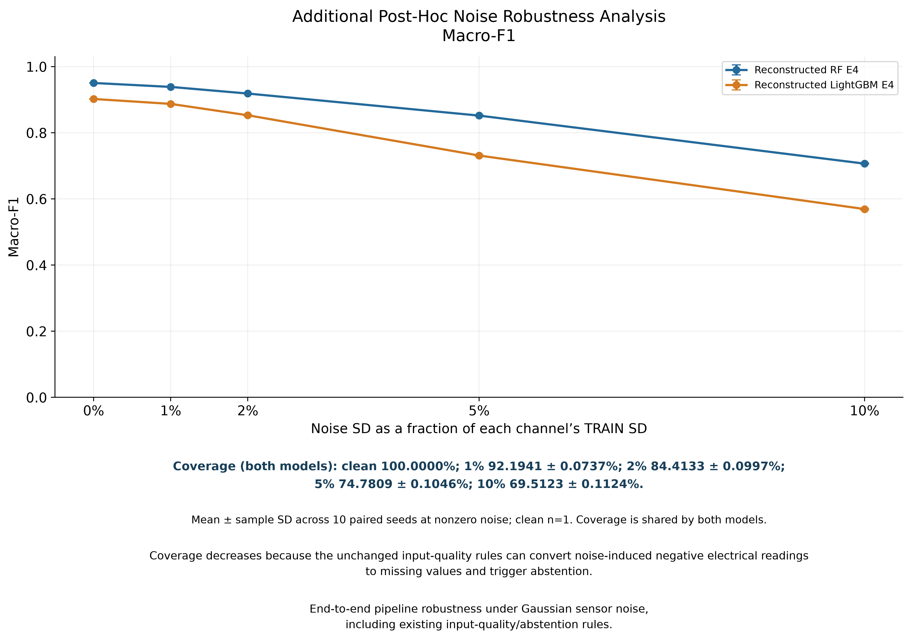
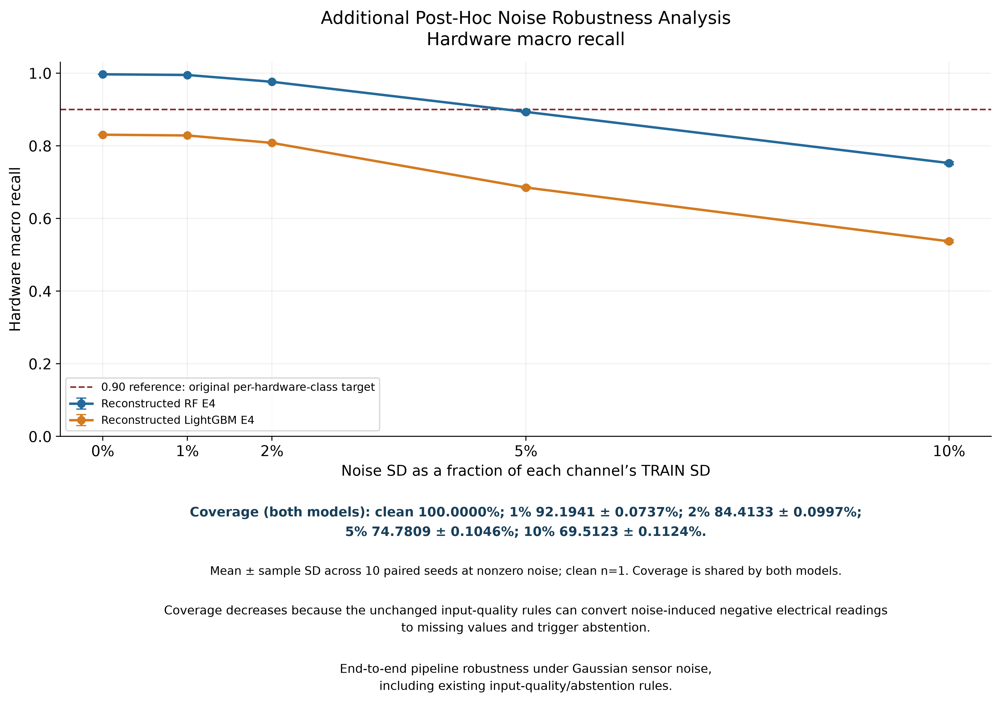
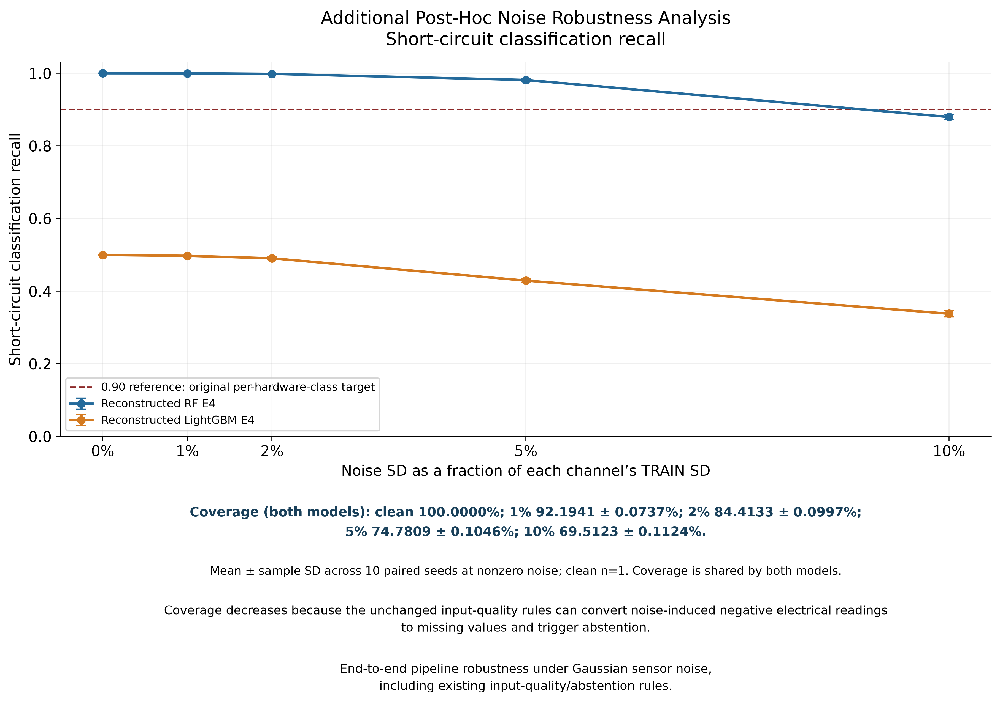
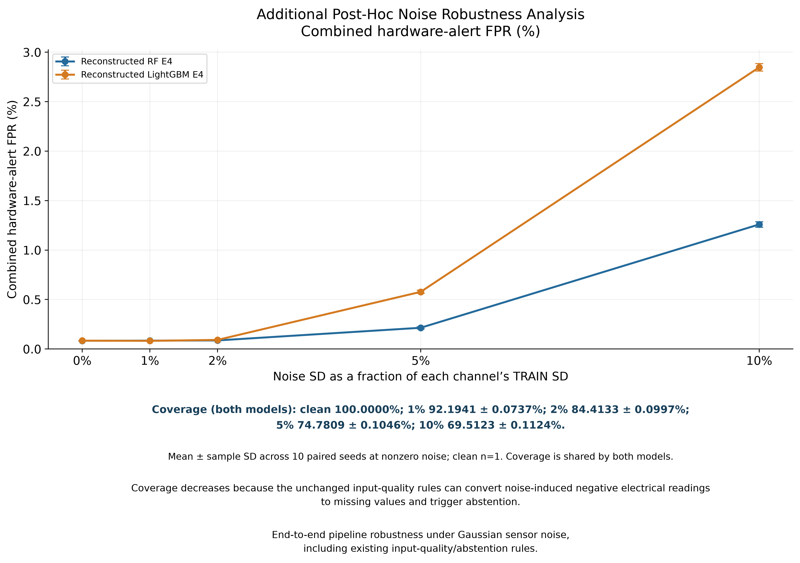

# Additional Post-Hoc Noise Robustness Analysis

## Scope and preserved history

This is a new sensitivity experiment **using behaviorally verified reconstructed models**, not recovered historical binaries. Historical Phase 2 results remain frozen at commit `34ab15ed18abb29defc0f30baa284f189fc05aef`. The original artifact-gate and recovery documents remain unchanged. This new-version report supersedes the stopped state only for the separately authorized reconstruction/noise study; it does not rewrite those records or the original engineering study.

Sensor measurement noise means additive input perturbation/error; it is not synonymous with outliers. Noise robustness was not an original predeclared engineering criterion. The original conclusion remains: **No evaluated configuration satisfied all predeclared engineering criteria.**

This evaluates end-to-end pipeline robustness under Gaussian sensor noise, including existing input-quality/abstention rules. Coverage is identical for both reconstructed models and declines under the unchanged quality rules; the reviewed figures and tables visibly annotate it.

## Reconstruction first: environment, fit provenance and behavioral gate

Python 3.14.7; NumPy 2.5.4; pandas 3.0.6; SciPy 1.18.1; scikit-learn 1.9.1; LightGBM 4.7.0; joblib 1.6.0; threadpoolctl 3.7.0. Required transitive versions were also checked against the frozen lock. These dependencies were installed in an isolated local environment, leaving the main environment unchanged. Raw SHA-256 is `717278fdc338bf6713293c0495421a8be9ea02a0b64144e86e957a531edecb8a`.

TRAIN [0,1006129), VALIDATION [1056990,1173967), block 13 [1056990,1089790), block 14 [1140571,1173967), TEST [1227337,1373798) are preserved. TRAIN class supports are 844805/1226/5695/1204/153199; TEST supports are 124512/2361/2270/2410/14908, N=146461. Full partition counts, fitted feature names, parameter sets, class weights, source hashes and environment are in `Reconstruction_Verification.json`.

New estimators use the complete frozen parameters, seed 42 and two threads. RF: 100 trees, depth 10, min_samples_leaf 20. LightGBM: 150 estimators, 31 leaves, depth 6, learning_rate 0.05, min_child_samples 50, max_bin 127, reg_lambda 1, deterministic and force_col_wise. Class weights are the original TRAIN-only values. Both use the unchanged Stage 2 preprocessing factory and fit method. Since the original Stage 1 caches were lost, the constructor's clone-from-cache step is transparently replaced with cloning an unfitted estimator instantiated from the complete frozen specification. No F6 search or threshold search is repeated. See `Reconstruction_Provenance.md`.

| Reconstruction | Gate | Macro-F1 difference | Recall differences: short/degradation/open | Max confusion-cell difference | Hardware-alert AP difference |
| --- | --- | --- | --- | --- | --- |
| Reconstructed RF E4 | B | 0.000000000000 | 0.000000000000/0.000000000000/0.000000000000 | 0 | -0.000000089591 |
| Reconstructed LightGBM E4 | A | 0.000000000000 | 0.000000000000/0.000000000000/0.000000000000 | 0 | 0.000000000000 |

RF is conservatively classified **B** because hardware-alert AP differs by -8.95910079457e-08; all five-class confusion counts, class/AP metrics and thresholded alert decisions/counts reproduce exactly within the recorded numerical tolerance. LightGBM is **A**, with all compared metrics and counts equal within tolerance. Both preserve all hardware-class reference outcomes and the model ranking. LightGBM short-circuit support is 2361, with 1179 correctly classified, 453 assigned degradation and 729 assigned shade. No threshold is changed: RF 0.5913558658757772; LightGBM 0.13860002397413157.

Both maximum confusion-cell differences and both confusion L1 differences are zero. Actual changed per-observation classifications cannot be established from aggregate confusion counts alone because original row-level predictions are absent; the minimum necessary changed-count bound is zero, which does not prove identical row-level predictions.

New model SHA-256 values:

- reconstructed RF E4: `8158761cd874d47ac193381f44ba1251b430d1855a39c678409e079b326b9070`.
- reconstructed LightGBM E4: `2eda421c4d6eb372806df4e973123d3661ae8bd39bd3dca79bd72eba6122662e`.

**Binary identity with the historical artifacts: NOT ESTABLISHED.** Reconstructed models and new clean prediction arrays are local only under the local-only reconstruction workspace. Historical and reconstructed clean metrics remain separately stored; degradation below uses each reconstruction's own clean baseline.

## Noise design and actual physical scales

For each physical channel j, x_noisy = x + epsilon, epsilon ~ Normal(0, (alpha × sigma_TRAIN,j)^2). E4 channels are vdc1, vdc2, idc1, idc2. Population standard deviations use ddof=0 on all 1,006,129 TRAIN observations, before any TEST analysis. The raw E4 TRAIN measurements are finite/nonnegative, so reference quality handling does not alter those values. No TEST statistic sets the noise amplitude.

| Channel | Unit | TRAIN mean | TRAIN SD (ddof=0) | Noise SD 1% | Noise SD 2% | Noise SD 5% | Noise SD 10% |
| --- | --- | --- | --- | --- | --- | --- | --- |
| vdc1 | V | 137.108374079 | 136.995757322 | 1.369957573 | 2.739915146 | 6.849787866 | 13.699575732 |
| vdc2 | V | 136.923536485 | 137.283171462 | 1.372831715 | 2.745663429 | 6.864158573 | 13.728317146 |
| idc1 | A | 2.248128547 | 3.125249817 | 0.031252498 | 0.062504996 | 0.156262491 | 0.312524982 |
| idc2 | A | 1.976315840 | 2.988747381 | 0.029887474 | 0.059774948 | 0.149437369 | 0.298874738 |

These displayed scales are rounded to nine decimals; `Noise_Scale_Diagnostics.csv` retains machine precision. Alpha 0.01 means noise SD equal to 1% of the channel's TRAIN SD, **not 1% error in each measurement**. Pooled TRAIN SD includes both low/high-signal regimes; a constant Gaussian amplitude can be large relative to near-zero readings and is not a calibrated field sensor specification.

Levels: 0%, 1%, 2%, 5%, 10%. Seeds: 101, 202, 303, 404, 505, 606, 707, 808, 909, 1010. There are ten repetitions per nonzero level and a single deterministic clean evaluation per model. SD across seeds is sample SD (ddof=1); clean SD=0 is a storage convention, not an uncertainty estimate. Seed variation quantifies synthetic-perturbation variation, not independent datasets or confidence intervals.

For each alpha/seed, one noisy physical DataFrame is passed to both models, with its content digest verified before/after each prediction. The same standardized draws for a seed are scaled across alpha, providing common noise directions across doses. All 40 paired hashes are recorded. Engineered inputs P1/P2/P_total/V_diff/I_diff are generated only by the existing frozen LightGBM transformation after physical perturbation and frozen median handling. Their consistency was checked against the actual transformed inputs for every pair. No noisy-data fitting or threshold optimization occurs.

## Overall, hardware-class and alert results

## Hardware-class recall under sensor measurement noise

| Noise | Model | Short recall | Degradation recall | Open recall | HW macro recall |
| --- | --- | --- | --- | --- | --- |
| 0% | RF E4 | 0.9996 | 0.9907 | 1.0000 | 0.9968 |
| 0% | LightGBM E4 | 0.4994 | 0.9930 | 0.9992 | 0.8305 |
| 1% | RF E4 | 0.9994 ± 0.0004 | 0.9895 ± 0.0012 | 0.9958 ± 0.0019 | 0.9949 ± 0.0007 |
| 1% | LightGBM E4 | 0.4971 ± 0.0011 | 0.9928 ± 0.0007 | 0.9954 ± 0.0018 | 0.8284 ± 0.0007 |
| 2% | RF E4 | 0.9979 ± 0.0007 | 0.9835 ± 0.0010 | 0.9472 ± 0.0036 | 0.9762 ± 0.0013 |
| 2% | LightGBM E4 | 0.4903 ± 0.0033 | 0.9870 ± 0.0021 | 0.9467 ± 0.0035 | 0.8080 ± 0.0019 |
| 5% | RF E4 | 0.9812 ± 0.0032 | 0.8869 ± 0.0073 | 0.8120 ± 0.0077 | 0.8934 ± 0.0029 |
| 5% | LightGBM E4 | 0.4288 ± 0.0043 | 0.8171 ± 0.0067 | 0.8096 ± 0.0075 | 0.6852 ± 0.0027 |
| 10% | RF E4 | 0.8792 ± 0.0067 | 0.6584 ± 0.0076 | 0.7198 ± 0.0073 | 0.7525 ± 0.0039 |
| 10% | LightGBM E4 | 0.3377 ± 0.0089 | 0.5643 ± 0.0099 | 0.7089 ± 0.0066 | 0.5370 ± 0.0036 |

## Overall classification under sensor measurement noise

| Noise | RF Macro-F1 | LightGBM Macro-F1 | RF HW macro recall | LightGBM HW macro recall |
| --- | --- | --- | --- | --- |
| 0% | 0.9505 | 0.9021 | 0.9968 | 0.8305 |
| 1% | 0.9386 ± 0.0003 | 0.8872 ± 0.0005 | 0.9949 ± 0.0007 | 0.8284 ± 0.0007 |
| 2% | 0.9185 ± 0.0008 | 0.8528 ± 0.0011 | 0.9762 ± 0.0013 | 0.8080 ± 0.0019 |
| 5% | 0.8519 ± 0.0009 | 0.7311 ± 0.0015 | 0.8934 ± 0.0029 | 0.6852 ± 0.0027 |
| 10% | 0.7066 ± 0.0014 | 0.5693 ± 0.0023 | 0.7525 ± 0.0039 | 0.5370 ± 0.0036 |

## Hardware alerts at the original frozen thresholds

| Noise | Model | Alert recall | Alert F1 | Combined FPR |
| --- | --- | --- | --- | --- |
| 0% | RF E4 | 0.9955 | 0.9896 | 0.0832% |
| 0% | LightGBM E4 | 0.9969 | 0.9902 | 0.0839% |
| 1% | RF E4 | 0.9930 ± 0.0007 | 0.9882 ± 0.0004 | 0.0843 ± 0.0022% |
| 1% | LightGBM E4 | 0.9944 ± 0.0012 | 0.9891 ± 0.0006 | 0.0821 ± 0.0026% |
| 2% | RF E4 | 0.9730 ± 0.0015 | 0.9778 ± 0.0009 | 0.0866 ± 0.0035% |
| 2% | LightGBM E4 | 0.9740 ± 0.0017 | 0.9778 ± 0.0010 | 0.0920 ± 0.0045% |
| 5% | RF E4 | 0.8867 ± 0.0040 | 0.9192 ± 0.0020 | 0.2144 ± 0.0107% |
| 5% | LightGBM E4 | 0.8889 ± 0.0026 | 0.8875 ± 0.0016 | 0.5775 ± 0.0163% |
| 10% | RF E4 | 0.7780 ± 0.0040 | 0.7675 ± 0.0032 | 1.2591 ± 0.0278% |
| 10% | LightGBM E4 | 0.8001 ± 0.0055 | 0.6770 ± 0.0040 | 2.8472 ± 0.0372% |

All values are means ± sample SD at noisy levels. AP is computed consistently from new probabilities using the unchanged frozen evaluation function; abstentions receive zero probability for AP and count as missed states/alerts for all-row recall. Alert score is p1+p2+p3 at the original model-specific threshold. Shade remains an environmental state; combined FPR negatives are Normal + Shade. All CSV FPR values are fractions; plots/presentation tables multiply by 100 for percentages. No probability calibration is claimed.

The 0.90 lines are descriptive references from the original **per-hardware-class** recall target. The line on the hardware-macro-recall plot is a visual reference only; it does not turn the original individual-class rule into an aggregate rule or create a new noisy acceptance criterion.

| Model | Hardware class | Mean recall first below 0.90 |
| --- | --- | --- |
| Reconstructed RF E4 | Short Circuit | 10% (first tested level) |
| Reconstructed RF E4 | Resistive Degradation | 5% (first tested level) |
| Reconstructed RF E4 | Open Circuit | 5% (first tested level) |
| Reconstructed LightGBM E4 | Short Circuit | Already below at clean baseline |
| Reconstructed LightGBM E4 | Resistive Degradation | 5% (first tested level) |
| Reconstructed LightGBM E4 | Open Circuit | 5% (first tested level) |

## Degradation and retention

Delta Macro-F1 and recall = reconstructed clean value minus noisy value; positive means degradation. Delta combined FPR = noisy minus clean; positive means worse. Retention = noisy Macro-F1 / reconstructed clean Macro-F1. Negative deltas, if present, are retained rather than clipped.

| Model | Maximum mean Macro-F1 drop | Retention at 10% | Relative loss at 10% | Combined FPR increase at 10% |
| --- | --- | --- | --- | --- |
| Reconstructed RF E4 | 0.243881 | 74.341% | 25.659% | 1.1759 percentage points |
| Reconstructed LightGBM E4 | 0.332858 | 63.103% | 36.897% | 2.7632 percentage points |

Maximum mean drops occur at 10% for both. The largest individual-seed observed drops are separately retained in `Noise_Robustness_Descriptive_Measures.csv`; these are not substitutes for the mean curves. Full mean/SD deltas, five-class metrics and AP are in `Noise_Robustness_Summary.csv`; individual runs are in `Noise_Robustness_Seed_Level.csv`.

## Coverage, physical validity and range diagnostics

No perturbation is clipped to TRAIN/TEST min/max. The original electrical validity rule treats values below zero as unavailable, applies the TRAIN-fitted medians for eligible isolated missingness, and abstains for multichannel or sustained missingness. This inherited rule is distinct from adding a new clipping rule. Its effects are part of these complete-pipeline robustness results, not solely estimator sensitivity.

| Noise SD / TRAIN SD | Coverage (both models) | Mean abstentions |
| --- | --- | --- |
| 0% | 100.000% | 0.0 |
| 1% | 92.194% | 11432.6 |
| 2% | 84.413% | 22828.4 |
| 5% | 74.781% | 36936.2 |
| 10% | 69.512% | 44652.6 |

Coverage is identical for both models because they have the same physical channels and quality/availability rule. At 10%, mean abstentions are 44,652.6, predominantly Normal (43,998.0) and Open Circuit (649.1). Noise near zero-valued electrical readings explains much of the coverage loss. Some false-alert rates can fall slightly under small noise/abstention, which is not an unconditional monitoring improvement; missed coverage remains visible.

The following counts/fractions are calculated on the raw perturbed measurements before pipeline quality handling. They are 'outside TRAIN range' diagnostics, not automatic invalid-outlier labels. Each denominator is 146,461 per repetition; noisy counts are ten-seed means. Counts can be nonzero even at clean TEST because TEST need not lie within TRAIN extrema. Complete per-seed counts and sample SDs remain in the range CSVs.

| Noise | Channel | Below TRAIN min: mean count / fraction | Above TRAIN max: mean count / fraction | Negative: mean count / fraction |
| --- | --- | --- | --- | --- |
| 0% | vdc1 | 0.0 / 0.0000% | 0.0 / 0.0000% | 0.0 / 0.0000% |
| 0% | vdc2 | 0.0 / 0.0000% | 0.0 / 0.0000% | 0.0 / 0.0000% |
| 0% | idc1 | 0.0 / 0.0000% | 0.0 / 0.0000% | 0.0 / 0.0000% |
| 0% | idc2 | 0.0 / 0.0000% | 0.0 / 0.0000% | 0.0 / 0.0000% |
| 1% | vdc1 | 26468.1 / 18.0718% | 0.0 / 0.0000% | 20035.0 / 13.6794% |
| 1% | vdc2 | 23854.0 / 16.2869% | 0.0 / 0.0000% | 18714.9 / 12.7781% |
| 1% | idc1 | 832.3 / 0.5683% | 0.0 / 0.0000% | 11.5 / 0.0079% |
| 1% | idc2 | 9107.7 / 6.2185% | 0.0 / 0.0000% | 7015.3 / 4.7899% |
| 2% | vdc1 | 28759.7 / 19.6364% | 0.0 / 0.0000% | 25363.7 / 17.3177% |
| 2% | vdc2 | 27276.3 / 18.6236% | 0.0 / 0.0000% | 24510.2 / 16.7350% |
| 2% | idc1 | 8872.2 / 6.0577% | 0.0 / 0.0000% | 2478.8 / 1.6925% |
| 2% | idc2 | 20213.9 / 13.8016% | 0.0 / 0.0000% | 18381.9 / 12.5507% |
| 5% | vdc1 | 30381.1 / 20.7435% | 0.3 / 0.0002% | 28989.7 / 19.7935% |
| 5% | vdc2 | 29678.5 / 20.2638% | 4.4 / 0.0030% | 28531.0 / 19.4803% |
| 5% | idc1 | 24141.0 / 16.4829% | 0.4 / 0.0003% | 17269.3 / 11.7911% |
| 5% | idc2 | 31314.5 / 21.3808% | 0.3 / 0.0002% | 30371.8 / 20.7371% |
| 10% | vdc1 | 31097.6 / 21.2327% | 19.0 / 0.0130% | 30382.3 / 20.7443% |
| 10% | vdc2 | 30623.2 / 20.9088% | 52.4 / 0.0358% | 30053.6 / 20.5199% |
| 10% | idc1 | 32804.3 / 22.3980% | 142.0 / 0.0970% | 28567.7 / 19.5053% |
| 10% | idc2 | 37075.1 / 25.3140% | 29.3 / 0.0200% | 36562.0 / 24.9636% |

## Highest-noise class behavior and main failure modes

| Class | RF recall at 10% | LightGBM recall at 10% | RF F1 at 10% | LightGBM F1 at 10% |
| --- | --- | --- | --- | --- |
| Normal | 0.5131 ± 0.0019 | 0.4902 ± 0.0018 | 0.6751 ± 0.0017 | 0.6502 ± 0.0017 |
| Short Circuit | 0.8792 ± 0.0067 | 0.3377 ± 0.0089 | 0.8718 ± 0.0053 | 0.4250 ± 0.0091 |
| Resistive Degradation | 0.6584 ± 0.0076 | 0.5643 ± 0.0099 | 0.4897 ± 0.0036 | 0.3713 ± 0.0053 |
| Open Circuit | 0.7198 ± 0.0073 | 0.7089 ± 0.0066 | 0.8365 ± 0.0049 | 0.8162 ± 0.0043 |
| Building Shade | 0.9739 ± 0.0014 | 0.8942 ± 0.0023 | 0.6599 ± 0.0012 | 0.5836 ± 0.0020 |

**Reconstructed RF E4**: largest mean error destinations at 10% noise are Normal → Abstain: 43998.0, Normal → Building Shade: 14471.8, Normal → Resistive Degradation: 2131.2, Open Circuit → Abstain: 649.1, Resistive Degradation → Normal: 528.9, Building Shade → Normal: 278.2, Resistive Degradation → Short Circuit: 245.3. These are average counts per repetition, not pooled independent observations.
**Reconstructed LightGBM E4**: largest mean error destinations at 10% noise are Normal → Abstain: 43998.0, Normal → Building Shade: 16850.6, Normal → Resistive Degradation: 2437.7, Building Shade → Normal: 1458.4, Short Circuit → Resistive Degradation: 795.9, Open Circuit → Abstain: 649.1, Resistive Degradation → Normal: 597.1. These are average counts per repetition, not pooled independent observations.

In hardware classes, RF's largest recall reduction is degradation (0.9907 to 0.6584); many degradation observations move to Normal or Short Circuit. LightGBM's short-circuit recall worsens from 0.4994 to 0.3377, with prominent confusion into degradation. Open-circuit recall declines similarly for both, largely through common abstention; no special open-circuit superiority is inferred from small clean differences.

## Explicit interpretation questions

1. **Macro-F1 maintenance:** RF has higher absolute Macro-F1 and greater retention at every tested nonzero level; its curve degrades more slowly under this protocol.
2. **Relative Macro-F1 degradation:** RF loses 25.659% of its clean Macro-F1 at 10%, versus 36.897% for LightGBM.
3. **Short Circuit:** RF remains stronger at every level; RF stays above the 0.90 reference through 5%, then falls to 0.8792 at 10%. LightGBM starts weak and worsens to 0.3377.
4. **Resistive Degradation:** LightGBM retains slightly higher absolute recall at clean/1%/2%; RF becomes stronger at 5%/10% and has the smaller high-noise decline. There is no universal per-level recall winner.
5. **Open Circuit:** RF has slightly higher mean recall across the tested levels; both suffer marked losses, largely common abstentions. At 10% the means are 0.7198 and 0.7089.
6. **Hardware macro recall:** RF remains higher at every level, reaching 0.7525 versus 0.5370 at 10%.
7. **Hardware-alert recall:** LightGBM remains slightly higher at every level and loses less at the highest dose; 0.8001 versus RF 0.7780 at 10%. Exact diagnosis and alerting remain separate.
8. **False hardware alerts:** RF has the smaller combined-FPR increase at 2%, 5% and 10%; at 1%, LightGBM's mean FPR is slightly below its clean value. The high-dose increases are 1.1759 versus 2.7632 percentage points.
9. **Trade-off:** The clean fault-type/resource trade-off remains, with a stronger RF advantage in Macro-F1 stability and false-alarm control under moderate/high noise. LightGBM's recall/resource advantage does not imply superior noise-robust diagnosis.
10. **LightGBM short-circuit weakness:** It worsens as noise increases, rather than being repaired by noise.
11. **RF stability:** RF is relatively more robust, but its strong clean performance is not stable throughout the full range: degradation/open recall first fall below the reference at 5%, and all three hardware-class means are below 0.90 at 10%.
12. **Main high-dose failure:** Both lose substantial monitoring availability; RF additionally confuses degradation with Normal/Short Circuit, while LightGBM combines short-circuit subtype confusion with a larger false hardware-alert burden. Both have many Normal-to-Shade confusions.

## Qualitative decision matrix and bounded recommendations

| Criterion | Reconstructed RF E4 | Reconstructed LightGBM E4 |
| --- | --- | --- |
| Clean exact fault classification | Stronger balanced fault-type identification | Strong Normal/Shade; short-circuit weakness preserved |
| Short-circuit identification | Higher recall at every tested noise level | Already below 0.90 clean; worsens with noise |
| Noise robustness | Higher Macro-F1 retention at every nonzero level; lower moderate/high-noise FPR growth | Larger Macro-F1 loss; higher false-alert burden at 5–10% |
| Binary hardware alerting | Lower recall but better alert F1 at 5–10%, lower combined FPR from 2% upward | Higher mean alert recall at every level; more false alerts at high noise |
| Latency (historical host reference) | 36.81 ms p95; no new timing claim | 6.12 ms p95; no new timing claim |
| Artifact size (historical reference) | 11.6654 MiB original fitted artifact | 1.5692 MiB original fitted artifact |
| Physical sensors | 4 measured channels | 4 measured channels |

Latency and artifact figures above are explicitly the **historical host-dependent resource references**. The new reconstructed models were not rebenchmarked; these numbers are not presented as new reconstruction timings/sizes. Their hashes and fit durations are recorded separately. Mathematical feature counts remain 8 for RF and 13 for LightGBM, both from four physical channels.

**Exact PV fault/state identification:** under the evaluated Gaussian sensor-noise protocol, reconstructed RF E4 is preferable among these two candidates. It has better fault-type sensitivity, Macro-F1 retention and moderate/high-noise false-alarm control. This does not make it globally optimal or satisfy the original resource limits.

**Resource-efficient binary hardware alerting:** LightGBM retains the historical computational advantage and slightly higher noisy alert recall. It is a conditional preference when resources/missed alerts dominate, especially under low-noise operation. At 5–10% noise, its markedly higher FPR and lower alert F1 weaken that choice. If false-alarm control under those doses is the priority, RF is preferable despite its historical resource failures. Neither is demonstrated acceptable for every operational objective, and no arbitrary combined score is used.

These are descriptive repeated synthetic perturbations on a previously exposed, dependent single-installation test partition. They do not establish field sensor error distributions, independent-site generalization, statistical proof of superiority, causal explanations, or universal robustness. The noise analysis does not alter the original conclusion or acceptance criteria.

## Artifacts, QA and preservation

Four high-resolution PNG/vector-PDF curves and three presentation-table PNG/PDF pairs were created. Values/error bars were independently checked against individual-seed CSV means and sample SDs. Every PNG was visually inspected for readability, clipping, units, reference-line labels and alignment. All passed. Tiny SDs can be visually smaller than the marker size; exact values remain in CSV.

The final pre-publication audit confirmed all 514 protected pre-existing files remained byte-identical. The original stopped gate/recovery files, Phase 1, authoritative Phase 2 report/source, IEEE candidate, published comparison and existing predictions remain unchanged. No original model cache was manufactured. Original scientific artifacts were not modified by the analysis.

New reconstruction fitting was explicitly authorized: two new estimators and their preprocessing were fitted on TRAIN only. There was **no refitting on clean TEST or noisy TEST**, no re-selection and no threshold tuning. New reconstructed-clean/noisy predictions were generated in separate storage; original clean predictions were not replaced.

For the exact output inventory and verification details, see `Noise_Robustness_Reconstructed_Verification.json`. This is the completed reconstructed-model analysis. The earlier stopped-gate and recovery-search records remain local and are omitted from this public bundle.
