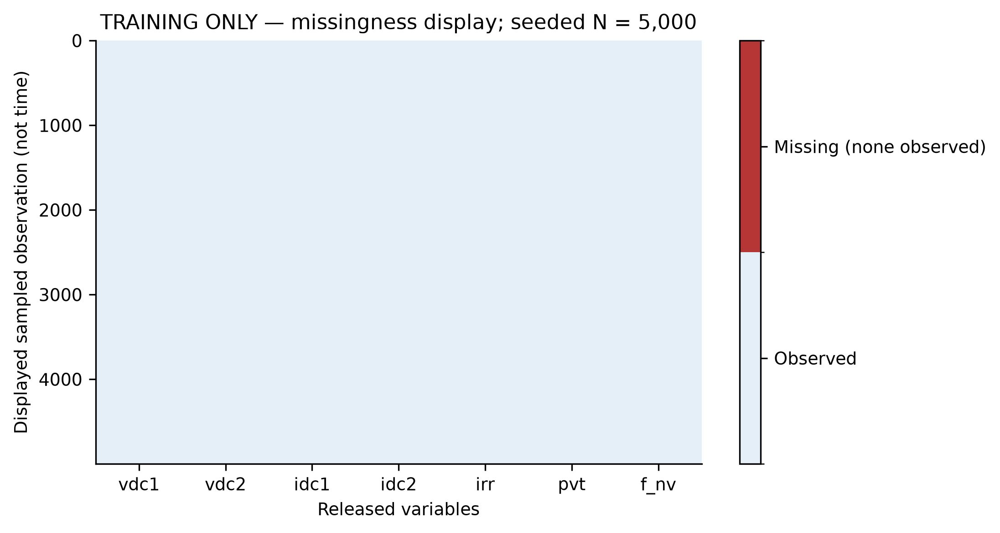
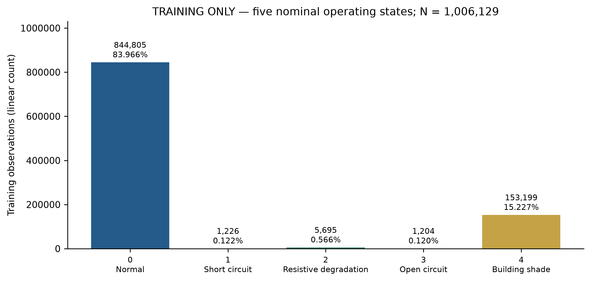
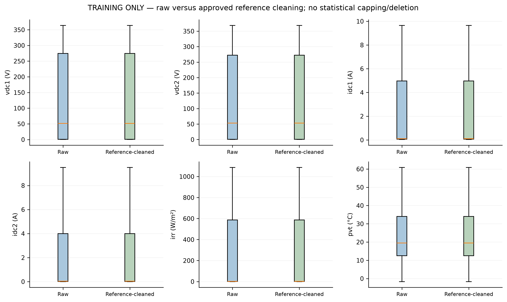
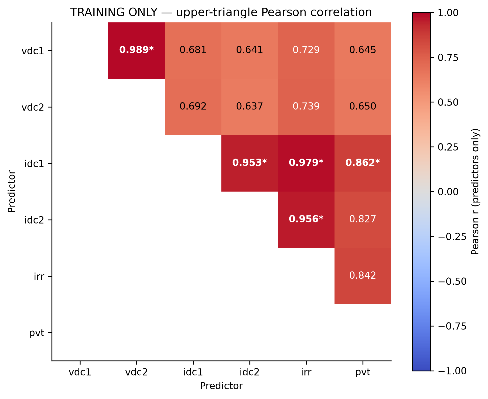
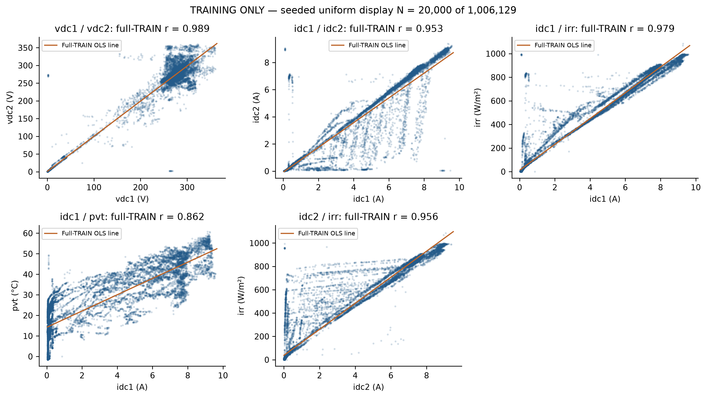
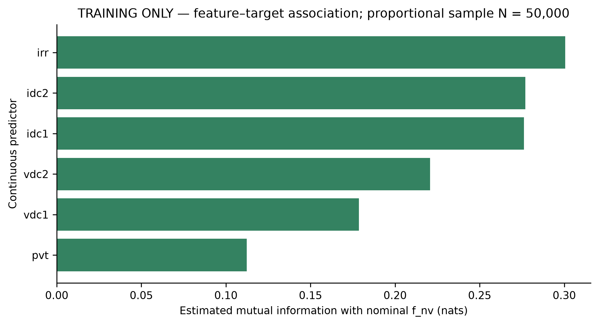
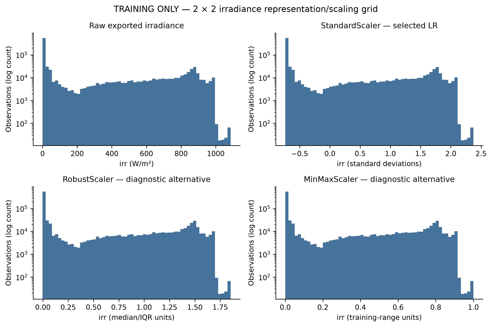
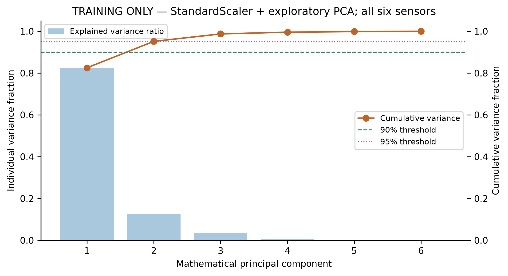

# Assignment 2: Data Preprocessing

Ruganji Prince | 04-652 Artificial Intelligence System Design

## 1. Scope and dataset

The current milestone covers acquisition, audit, train-only preprocessing and exploratory diagnostics. The immutable source export contains 1,373,798 observations and seven variables: vdc1/vdc2 (V), idc1/idc2 (A), irradiance irr (W/m²), module temperature pvt (°C), and nominal f_nv. Labels are 0 normal, 1 short circuit, 2 resistive degradation, 3 open circuit, and 4 natural building shade. Six predictors are continuous float64; the target is uint8 storage representing nominal categories. No categorical predictors require encoding. Downstream predictive outcomes are outside this report.

## 2. Source and population discrepancy

The original-author dataset is pinned at e9ed8ad8072dcb3ffc643b0f3604219798708551. Lazzaretti et al. (Sensors 20, 4688, 2020; DOI 10.3390/s20174688) provides experiment context. The paired source vectors are provisionally aligned by exported order, not verified timestamps. Filtering irr >= 100 W/m² yields 515,958 observations and literature class counts [309253, 5999, 10371, 6024, 184311]. This exact numerical match suggests a possible population explanation, but the source does not explicitly document that exact filtering operation. All raw positions are retained rather than removed to force agreement.

## 3. Missingness and suspicious values

All seven variables contain zero conventional missing cells: 0/9,616,586 (0%). All 1,373,798 rows are complete. No empirical MCAR/MAR/MNAR mechanism can be inferred from zero exported NaNs; omitted intervals remain unobservable. The 62 paired irr=0/pvt=0 positions, in runs of 1/32/29, remain suspicious observations rather than confirmed missingness. One irradiance observation is -0.0381 W/m². The existing near-zero convention clamps -1 <= irr < 0 to zero; irradiance below -1 and negative electrical measurements would become unavailable, while valid negative Celsius measurements are retained. The raw CSV is not altered.

## 4. Cleaning and imputation

No statistical outlier capping or row deletion is selected because unusual observations may contain genuine fault information. TRAIN IQR fences are Q1 - 1.5 IQR and Q3 + 1.5 IQR; |Z| > 3 is a distribution-qualified complementary screen. Existing distribution/skewness evidence supports median contingency imputation rather than outlier-sensitive means. Mode is unsuitable for continuous measurements; KNN adds distance/compute assumptions, and interpolation requires continuity unavailable in the export. Low-light medians can be unsuitable during generation, so contingency assumptions remain explicit. Retained-channel availability indicators preserve missingness information. At most one missing retained channel for at most two consecutive source positions is eligible under the existing contingency mask; multi-channel/sustained unavailability is flagged. All arrays retain row alignment.

## 5. Target distribution and statistical matching

The raw class counts are [1162931, 5999, 10371, 6024, 188473]. TRAIN counts are [844805, 1226, 5695, 1204, 153199], with normal approximately 83.966%. Labels remain nominal and are separated from predictors. No synthetic resampling is performed. Continuous predictor pairs use descriptive Pearson correlation; Spearman can provide a rank-based sensitivity analysis but is not newly claimed here. Continuous predictors versus the five-class nominal target use descriptive mutual information, not Pearson on integer target codes. The retained Phase 1 data-type/test strategy distinguishes continuous, binary, nominal and ordinal cases; no unsupported p-value claim is made for dependent observations.

## 6. Feature relationships and collinearity

Five TRAIN predictor pairs exceed |r| >= 0.85. VIF values are vdc1=52.168202, vdc2=56.345662, idc1=31.495610, idc2=15.780847, irr=39.292651, pvt=4.069798. Five exceed 10. Dependence warnings do not prove physical redundancy; no automatic predictor deletion follows. Scatterplots display a seed-42 uniform 20,000-position TRAIN sample with full-TRAIN descriptive OLS lines. Mutual information uses a seed-42 proportional stratified TRAIN sample of 50,000, k=3, continuous predictors and nominal target. Repeated measurements, ties and class imbalance limit causal or inferential interpretation.

## 7. Split and leakage prevention

The original ordered partitions are TRAIN [0,1006129), N=1,006,129; VALIDATION [1056990,1173967), N=116,977; TEST [1227337,1373798), N=146,461. Two separator intervals exclude 104,231 positions. Sixteen signal-defined blocks follow a 12/2/2 allocation, not verified days/sessions. The rule is irr < 100 W/m² for at least 3,600 source positions, not a verified hour. The source study describes nominal 1 Hz acquisition, per-second electrical RMS values, one-second environmental averages and a 16-day experiment, but no timestamps identify uninterrupted intervals. Naive random row splitting would mix strongly dependent neighboring measurements. The original validation sub-block roles remain planning metadata; no downstream decision is repeated here. Medians, scalers and PCA fit only on TRAIN; validation/test are transform-only. Labels, acquisition index and block identity are excluded from predictive inputs. Historical exposure means the reserved partition is not asserted to be pristine.

## 8. Pipeline implementation and dimensions

Scikit-Learn Pipeline and ColumnTransformer implement the existing quality rules, TRAIN-median fallback, optional target-free physical features, optional StandardScaler, and all retained-channel indicators. Three existing representations are demonstrated without comparing trained predictors: six_standard has 6 raw + 6 indicators = 12 mathematical inputs; electrical_native has 4 raw + 4 indicators = 8; electrical_derived has 4 raw + 5 physical derivatives + 4 indicators = 13. Physical channel counts remain 6/4/4. P1, P2 and P_total are RMS voltage/current products and proxies, with absolute voltage/current differences also available; each derived feature uses only retained parents. No adequacy or optimal sensing conclusion follows from these dimensions.

## 9. Scaling, transformations and PCA

StandardScaler is retained for the standardized representation because unequal units distort later regularized or distance-sensitive analysis; tree-oriented representations remain native-scale. RobustScaler and MinMaxScaler are descriptive alternatives. Scaling does not Gaussianize skewed data. No log transform is introduced. Full-TRAIN StandardScaler and full-SVD PCA explain approximately 95.1677% with the first two components; two components cross both the 90% and 95% cutoffs. PCA is mathematical dimensionality reduction, not proof that only two physical sensors are required; all six measurements are needed to compute those components.

## 10. Reproducibility and limitations

The notebook loads the immutable CSV, executes target-free preprocessing, validates output dimensions and compares descriptive statistics with the original verified reference. The eight original 300-DPI figures are retained byte-for-byte rather than regenerated. The standalone code has no model cache dependency. No new predictive experiment is included. Duplicate removal is not claimed. A single controlled Brazilian installation, dependent source positions, uncertain continuous timing, provisional paired-vector alignment and unavailable independent sites limit transferability. Further course stages may address predictive modeling; no current-stage deployment claim is made.

## Diagnostic 1: Missingness pattern

Seed-42 uniform TRAIN display. Full released-data audit: 0 conventional missing cells across all seven variables. The 62 paired zeros remain observations, not confirmed missing values.

## Diagnostic 2: Target class distribution

All TRAIN labels, without rebalancing. Counts and percentages expose rare hardware states; accuracy alone is inadequate. Class 4 is natural building shade, not hardware failure.

## Diagnostic 3: Raw vs reference-cleaned boxplots

Full TRAIN IQR box statistics and fliers are shown. Reference cleaning is the existing RetainedQuality policy; unusual values remain. Nearly identical panels reflect intentional retention, not failed cleaning. Units are channel-specific.

## Diagnostic 4: Training predictor correlation

All six raw TRAIN predictors; f_nv is excluded. Asterisks mark |r| >= 0.85 (five pairs), matching Phase 1. Screening warns about redundancy; the preprocessing reference retains physical channels for possible later study, rather than automatically dropping them.

## Diagnostic 5: Collinear predictor pairs

All five Phase 1 high-correlation pairs. Points are a uniform seed-42 TRAIN sample; correlations and descriptive OLS lines use full TRAIN. Association is not causation; dependence precludes naive significance claims.

## Diagnostic 6: Feature-target mutual information

Seed-42 proportional stratified TRAIN sample, k=3 continuous-feature MI estimator; train-fitted standardization. Target codes remain nominal. This descriptive diagnostic does not alter preprocessing choices; imbalance, repeated readings and ties limit interpretation.

## Diagnostic 7: Transformation/scaling comparison

All learned scaler parameters use full TRAIN. Scaling changes units, not the underlying skewed shape. StandardScaler aligns LR regularization; RF/LightGBM retain native scale. Robust/MinMax are diagnostic alternatives only. Optional log1p is not introduced into frozen pipelines.

## Diagnostic 8: PCA scree and cumulative variance

StandardScaler and full-SVD PCA are fitted to full TRAIN only. PCA is an exploratory mathematical diagnostic, not physical sensor reduction, a feature-selection rule, or a change to the preprocessing policies. All six inputs are needed to compute the components.

## Preprocessing strategy versus reality

See [the complete preprocessing comparison](../compliance/Strategy_vs_Reality.md).

Lazzaretti et al., A Monitoring System for Online Fault Detection and Classification in Photovoltaic Plants, Sensors 20(17), 4688 (2020), https://doi.org/10.3390/s20174688.

Original-author dataset: https://github.com/clayton-h-costa/pv_fault_dataset, pinned commit e9ed8ad8072dcb3ffc643b0f3604219798708551; original README and Apache-2.0 license retained.

Approved Phase 1 strategy report and original audit CSV/JSON files in phase1_strategy/.

Scikit-Learn Pipeline, ColumnTransformer, preprocessing, mutual_info_classif and PCA APIs; exact existing versions in the preprocessing requirements.
