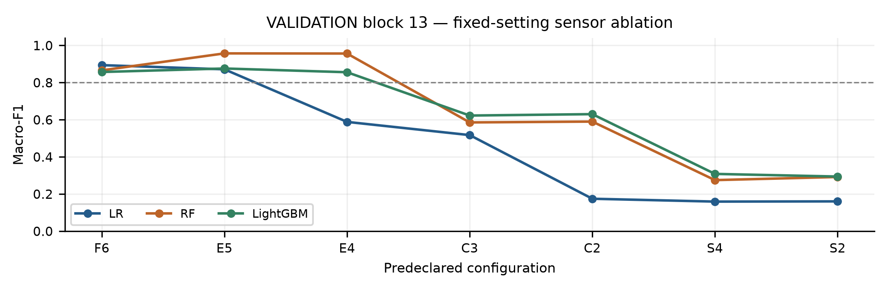
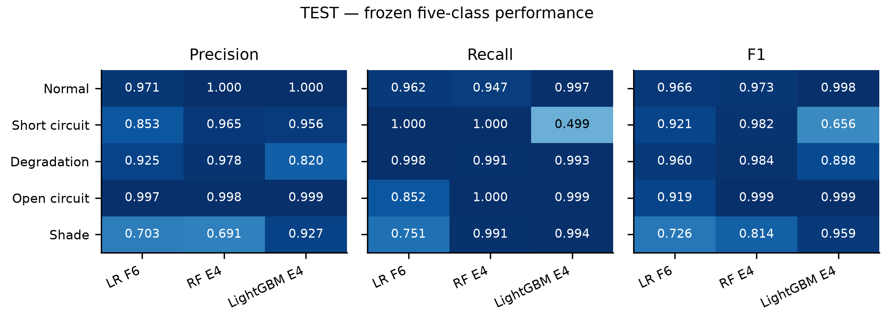
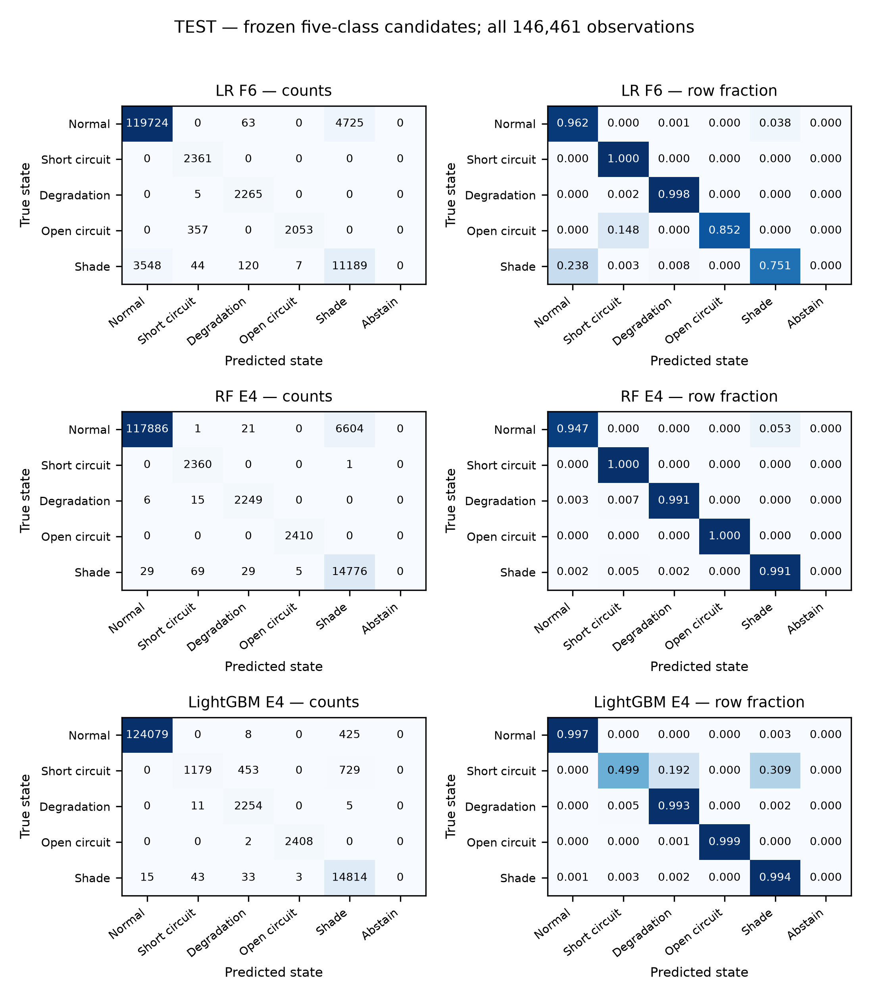
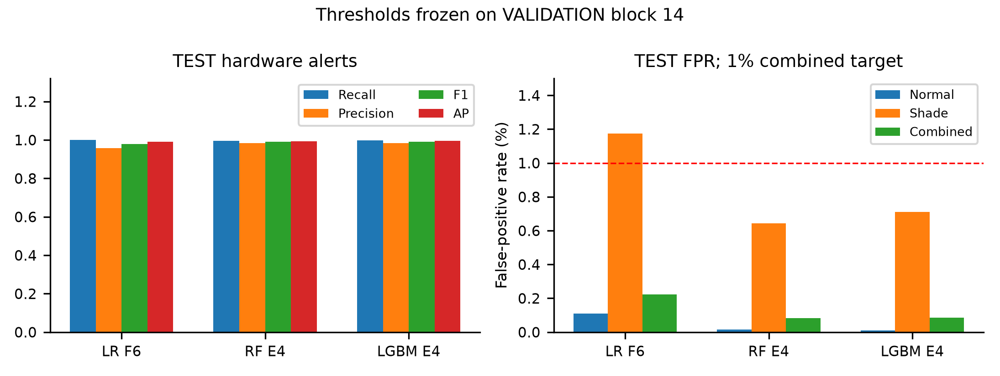
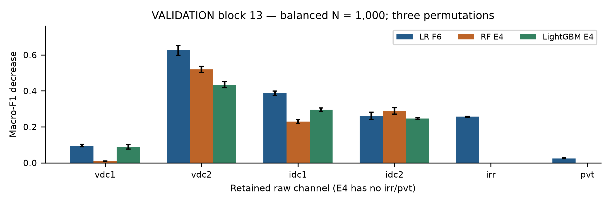
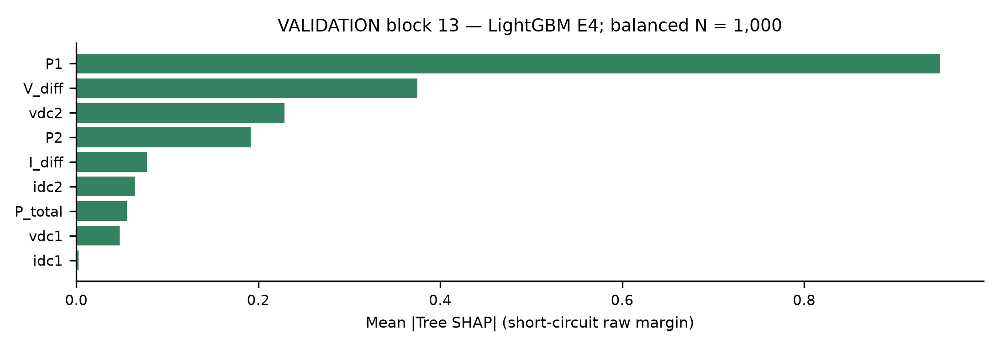
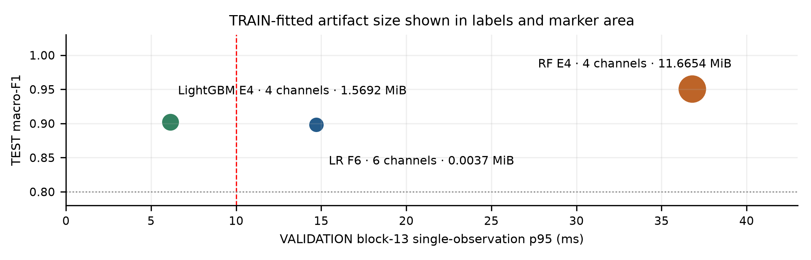

# Resource-Efficient and Explainable AI for Photovoltaic Anomaly Detection Under Sparse Sensing Constraints

Phase 2: Experimental Evaluation and Engineering Trade-offs

Ruganji Prince · Carnegie Mellon University Africa
04-652 Artificial Intelligence System Design · Assignment 2 · October 2026

## Abstract

This study evaluates whether photovoltaic operating-state classification can retain useful fault sensitivity with fewer physical measurement channels and limited computational resources. Training-only preprocessing, bounded model selection and seven predeclared sensor configurations compare Logistic Regression (LR), Random Forest (RF) and LightGBM. The frozen RF E4 candidate achieves test macro-F1 0.9505 from four electrical channels, with each hardware-state recall above 0.99, but exceeds latency and artifact-size limits. LightGBM E4 meets both resource limits but achieves short-circuit classification recall 0.4994, despite aggregate hardware-alert recall 0.9969. No evaluated configuration satisfied all predeclared engineering criteria. The results identify a measured sensing–prediction–computation trade-off. Prior test exposure and absent explicit timestamps limit interpretation.

## 1. Introduction and Phase 2 objective

The engineering objective is to identify a practically useful sensing and computational configuration for PV anomaly detection rather than maximize one aggregate score. Reliable electricity and affordable monitoring motivate the application in relation to SDG 7 [1]. Evidence derives from one controlled Brazilian PV installation [2,3]; Rwanda or other field generalization is not established. The task is observation-level multiclass classification, not forecasting or detection-delay estimation.

## 2. Phase 1 decisions carried forward

The approved Phase 1 PDF, raw export, labels, buffered split, seven sensor sets and engineering thresholds remain unchanged. Training-fitted median contingency imputation and retained-channel availability indicators are used; LR receives StandardScaler and trees retain native scale. Statistical outliers are retained. The 62 paired irradiance/temperature zeros remain suspicious observations rather than confirmed missing values. Slightly negative irradiance is clamped under the predeclared near-zero convention; negative Celsius values remain valid. Neither source index nor block identity is a predictor.

## 3. Professor feedback and Phase 2 extensions

The implementation addresses the row-count discrepancy, class imbalance, hardware-fault versus environmental-shade distinction and timestamp limitations. A bounded LightGBM comparison extends the linear/tree references. Explicit physical-feature dependencies, fixed-setting sensor ablation, alert thresholds, single-observation resource measurements and validation explanations support the sensing/resource question. All outcomes derive from approved frozen evidence without post-test tuning.

## 4. Dataset and row-count investigation

**Table 1. Dataset and task summary**

| Property | Frozen definition |
| --- | --- |
| Source | Original-author PV Fault Dataset [2,3]; pinned commit e9ed8ad8072dcb3ffc643b0f3604219798708551 |
| Dimensions | N = 1,373,798 source positions; P = 7 variables (6 predictors + 1 target) |
| Predictors | vdc1, vdc2 (DC RMS voltage, V); idc1, idc2 (DC RMS current, A); irr (plane-of-array irradiance, W/m²); pvt (module temperature, °C) |
| Target | f_nv: five nominal labels; integer codes are neither ordinal nor continuous |
| Class counts (0–4) | 1,162,931; 5,999; 10,371; 6,024; 188,473 |
| States | 0 normal; 1 short circuit; 2 resistive degradation; 3 open circuit; 4 natural building shade |
| Missingness | 0 conventional missing cells; 62 paired irr = 0 / pvt = 0 observations retained |
| Time metadata | No explicit timestamp; source order preserved |

The complete released arrays/export contain 1,373,798 positions, whereas the paper-reported class counts total 515,958. The irr ≥ 100 W/m² subset contains exactly 515,958 positions and reproduces every paper-reported count: 309,253 normal; 5,999 short circuit; 10,371 degradation; 6,024 open circuit; 184,311 shade. Exact numerical agreement is verified. An irradiance-qualified published population is plausible, but the inspected source does not explicitly establish use of that filtering operation. The primary experiment retains the approved full population; low irradiance is not automatically interpreted as nighttime.

The study describes nominal 1 Hz acquisition, per-second electrical RMS calculations, one-second irradiance/temperature averages and a 16-day experiment [2]. No timestamp variable exists in the released MAT/CSV data. Absolute timestamps and uninterrupted one-second spacing throughout the export cannot be verified; no synthetic timestamps are assigned.

## 5. Experimental methodology

## 5.1 Leakage-safe ordered split

Sixteen signal-defined blocks use irr < 100 W/m² for at least 3,600 consecutive source positions. Blocks are not verified days, sessions or hours. Adjacent-position dependence motivates ordered buffered splitting instead of naive random rows. TRAIN: blocks 1–12, [0,1006129), N = 1,006,129. VALIDATION: [1056990,1173967), N = 116,977; block 13, [1056990,1089790), N = 32,800, selects model settings; block 14, [1140571,1173967), N = 33,396, selects alert thresholds. TEST: blocks 15–16, [1227337,1373798), N = 146,461. Two separator regions exclude 104,231 positions. Validation separator positions outside the designated selection blocks are not additional selection data.

## 5.2 Physical feature engineering

LightGBM uses P1 = vdc1 × idc1; P2 = vdc2 × idc2; P_total = P1 + P2; V_diff = |vdc1 − vdc2|; I_diff = |idc1 − idc2|. A feature requires every parent channel. P1/P2 are RMS-product proxies, not independently measured power sensors. Derivatives do not reduce physical sensing requirements. LR/RF use retained raw channels plus availability indicators. No additional ratios are introduced.

## 5.3 Training-only imbalance handling and preprocessing

Normal comprises approximately 84.65% of the full export; hardware states are rare. Weights follow w_k = N_train / (K × n_k), K = 5, from TRAIN only. Training class counts are 844,805; 1,226; 5,695; 1,204; 153,199. Corresponding weights are 0.238192; 164.131974; 35.333766; 167.131063; 1.313493. One explicit class-weight mechanism is used. No SMOTE or synthetic oversampling is applied; validation/test distributions are not rebalanced.

Pipeline-owned medians and LR scaling are fitted only on TRAIN. Isolated one-channel unavailability permits imputation for the first two consecutive source positions; sustained or multichannel loss abstains. Runs reset across source gaps/block boundaries and separate batches. Removed channels are never reconstructed. Correlation/VIF warnings motivate regularization and physical ablation rather than automatic sensor deletion. No statistical winsorization, log transform or PCA is added to the frozen primary pipelines. PCA would reduce mathematical dimension, not physical sensor requirements.

## 5.4 Models and bounded selection

Sixteen F6 trials compare weighted/unweighted LR (C = 0.1 or 1.0), RF (depth 6 or 10), and LightGBM (15 leaves/depth 4 or 31 leaves/depth 6; raw/engineered features). Block-13 selection freezes balanced LR C = 1.0 (lbfgs, max_iter = 2,000); balanced RF depth 10 (100 trees, min_samples_leaf = 20); and balanced engineered LightGBM (31 leaves, depth 6, 150 estimators, learning_rate = 0.05, min_child_samples = 50, max_bin = 127, reg_lambda = 1). Seed 42 and two-thread settings where applicable remain fixed. Sparse configurations receive no independent hyperparameter search. Complete parameters remain in machine-readable evidence.

## 5.5 Predeclared sensor configurations

**Table 2. Physical channels retained**

| Set | Channels | Count |
| --- | --- | --- |
| F6 | vdc1, vdc2, idc1, idc2, irr, pvt | 6 |
| E5 | vdc1, vdc2, idc1, idc2, irr | 5 |
| E4 | vdc1, vdc2, idc1, idc2 | 4 |
| C3 | idc1, idc2, irr | 3 |
| C2 | idc1, idc2 | 2 |
| S4 | vdc1, idc1, irr, pvt | 4 |
| S2 | vdc1, idc1 | 2 |

Channel counts differ from mathematical feature counts and physical device counts.

## 5.6 Evaluation metrics

Macro-F1 is primary; weighted-F1 and classwise precision/recall/F1 and one-vs-rest average precision (AP) are complementary. Macro AP is the unweighted mean of five AP values, not trapezoidal PR integration. Hardware macro recall is (R1 + R2 + R3)/3. Hardware H = {1,2,3}; natural building shade is not hardware failure. Abstentions count as misses in all-row recall. Hardware-to-normal/shade confusions are explicit. Accuracy is not the selection objective.

## 5.7 Predeclared engineering criteria

Aspirations are macro-F1 ≥ 0.80; each hardware-class recall ≥ 0.90; same-family sparse Δ_s ≤ 0.05; at most four channels for sparse candidates; combined normal/shade alert FPR ≤ 1%; single-observation p95 ≤ 10 ms; complete artifact ≤ 10 MiB; isolated 1% dropout macro-F1 loss ≤ 0.05. These are project aspirations, not safety or certification thresholds.

## 6. Validation and sensor ablation

Each frozen family is trained on the same TRAIN population for all seven sets and evaluated on VALIDATION block 13. The 21 fits preserve settings and weights. Table 3 and Fig. 1 report validation macro-F1; no test score enters this comparison.

**Table 3. VALIDATION block-13 macro-F1 with fixed family settings**

| Set | Channels | LR | RF | LightGBM |
| --- | --- | --- | --- | --- |
| F6 | 6 | 0.8939 | 0.8658 | 0.8569 |
| E5 | 5 | 0.8713 | 0.9571 | 0.8758 |
| E4 | 4 | 0.5882 | 0.9563 | 0.8557 |
| C3 | 3 | 0.5172 | 0.5854 | 0.6225 |
| C2 | 2 | 0.1745 | 0.5899 | 0.6300 |
| S4 | 4 | 0.1591 | 0.2748 | 0.3082 |
| S2 | 2 | 0.1603 | 0.2916 | 0.2940 |

**Fig. 1.** VALIDATION block 13: fixed-setting sensor-ablation macro-F1. The horizontal line denotes the 0.80 aspiration.

RF E4 retains strong predictive performance and is the only configuration satisfying all four validation predictive/channel conditions: macro-F1, individual hardware recalls, family-specific degradation and at most four channels. Reductions below E4 generally cause substantial degradation. Removing voltage channels is particularly damaging in tested C2/C3 configurations. Environmental-channel removal does not universally reduce shade classification. These comparisons do not establish causal redundancy. Sparse engineered models do not isolate an engineering effect against matched raw-feature controls.

## 7. Frozen final candidates

LR F6 is the full-sensing lightweight reference. RF E4 is the sparse predictive-performance candidate and the minimum-channel qualifying candidate among the seven predeclared sensor configurations tested, based on the four validation predictive/channel conditions. This does not establish global minimum sensing or final engineering acceptance. LightGBM E4 remains the sparse resource-efficient candidate despite weak validation short-circuit classification. Candidates and settings were frozen before block-14 threshold selection and final TEST. No universal best model is asserted.

## 8. Final test results

Frozen candidates are evaluated on unchanged TEST without irradiance filtering or rebalancing. This partition had been evaluated in a legacy implementation and is not pristine or previously unseen. Revised model/sensor/feature decisions use training/validation evidence; no legacy test outcomes are loaded for revised selection. Earlier human exposure remains a limitation (Section 13).

**Table 4. TEST classification of frozen candidates**

| Metric | LR F6 | RF E4 | LightGBM E4 |
| --- | --- | --- | --- |
| Macro-F1 | 0.8984 | 0.9505 | 0.9021 |
| Weighted-F1 | 0.9403 | 0.9572 | 0.9872 |
| Macro AP | 0.9174 | 0.9762 | 0.9936 |
| Short-circuit recall R1 | 1.0000 | 0.9996 | 0.4994 |
| Degradation recall R2 | 0.9978 | 0.9907 | 0.9930 |
| Open-circuit recall R3 | 0.8519 | 1.0000 | 0.9992 |
| Hardware macro recall | 0.9499 | 0.9968 | 0.8305 |
| Same-family TEST Δ_s | N/A | -0.006291 | -0.002549 |

Sparse degradation uses frozen RF F6 / LightGBM F6 TEST references, never LR F6. Negative values are preserved.

**Fig. 2.** TEST: per-class precision, recall and F1. Shade remains an environmental operating state.

RF E4 achieves the strongest macro-F1 among the frozen candidates and hardware macro recall 0.9968, but resource compliance is separate. LightGBM E4 has high weighted-F1 and macro AP while short-circuit recall remains low. Aggregate scores do not supersede the individual-class requirement. Shade recall is 0.7505 for LR F6, 0.9911 for RF E4 and 0.9937 for LightGBM E4.

Detailed evidence contains all class metrics/supports. Confusions (Fig. 3) include 357 LR open-circuit observations assigned to short circuit, rather than normal or shade. RF assigns six degradation observations to normal and one short-circuit observation to shade. LightGBM assigns 729 short-circuit observations to shade and 453 to degradation; five degradation observations are assigned to shade. No model or threshold change follows these findings.

## 8.1 Final test confusion diagnostics

**Fig. 3.** TEST: counts and row-normalized confusions. Rows are true labels; columns are predictions, including abstention. Supports remain unchanged. Layout derives directly from frozen JSON; predictions are not regenerated.

All candidates have complete reference-test coverage. Aggregate hardware alerting remains separate from five-class diagnosis.

## 9. Hardware-alert evaluation

Hardware score s_H = p(class 1) + p(class 2) + p(class 3) alerts when s_H ≥ τ. VALIDATION block 14 alone selects τ to maximize alert recall subject to combined FPR ≤ 1% among Y ∈ {0,4}; equal-recall points prefer lower combined FPR, then higher τ. Distinct tied-score points and a no-alert sentinel are enumerated. Thresholds, model hashes and a freeze receipt precede revised test access. No threshold is adjusted after TEST.

**Table 5. VALIDATION block-14 threshold selection**

| Candidate | Frozen τ | Recall | Precision | Combined FPR |
| --- | --- | --- | --- | --- |
| LR F6 | 0.41938211 | 1.0000 | 0.9622 | 0.4694% |
| RF E4 | 0.59135587 | 1.0000 | 0.9765 | 0.2883% |
| LightGBM E4 | 0.13860002 | 1.0000 | 0.9770 | 0.2816% |

Exact thresholds remain in JSON. All candidates achieve 1.0000 validation alert recall without selecting the zero-alert sentinel.

**Table 6. TEST hardware alerts with frozen thresholds**

| Metric | LR F6 | RF E4 | LightGBM E4 |
| --- | --- | --- | --- |
| Alert recall | 1.0000 | 0.9955 | 0.9969 |
| Alert precision | 0.9578 | 0.9837 | 0.9836 |
| Alert F1 | 0.9785 | 0.9896 | 0.9902 |
| Hardware AP | 0.9896 | 0.9934 | 0.9948 |
| Normal FPR | 0.1084% | 0.0161% | 0.0088% |
| Shade FPR | 1.1739% | 0.6439% | 0.7110% |
| Combined FPR | 0.2223% | 0.0832% | 0.0839% |

**Fig. 4.** TEST: hardware-alert performance and separate FPRs. Thresholds originate only from VALIDATION block 14. The 1% target applies to combined FPR.

All combined TEST FPRs satisfy 1%. LR shade-only FPR exceeds 1% and remains visible. LightGBM alert recall 0.9969 alongside short-circuit classification recall 0.4994 is not contradictory: summed hardware probability can exceed τ even when another state has the largest individual probability. Some short-circuit observations are classified as degradation; others are labeled shade despite a sufficient summed hardware score. Strong aggregate detection therefore does not establish reliable fault-type diagnosis.

## 10. Explainability

Explanations use a seeded, balanced sample of 1,000 VALIDATION block-13 observations, 200 per class (seed 42). This supports class comparison but does not represent natural prevalence. LR standardized coefficients, RF impurity importance and LightGBM split gain describe fitted models. Three raw-channel permutation repeats rerun the complete pipeline and regenerate every dependent feature. Correlation disruption can create implausible combinations; losses describe model associations, not causal sensor effects.

**Fig. 5.** VALIDATION block 13, balanced N = 1,000: raw-channel permutation macro-F1 losses (three repeats); dependent features are regenerated.

vdc2 has the largest raw-channel permutation loss in every candidate; current channels also contribute substantially. LR additionally relies on irradiance. RF E4 retains useful electrical information without irr/pvt, but environmental sensing is not proved universally unnecessary. Aggressive validation sensor reduction is consistent with lost predictive information, not a unique physical mechanism.

**Fig. 6.** VALIDATION block 13, balanced N = 1,000: LightGBM E4 short-circuit Tree SHAP for nine numerical features in raw-margin units; availability indicators have zero contribution. Derived features are not independent sensors.

Native LightGBM Tree SHAP [4,5] emphasizes P1, V_diff and vdc2 for short circuit; vdc2/idc1 for degradation; and V_diff/I_diff for open circuit. Raw-margin additivity is verified to maximum error 6.13 × 10⁻¹⁴. These associations are not causal explanations of errors. Deterministic dependencies/correlation limit unique attribution. Optional RF SHAP was not run; RF native and raw-channel permutation analyses are provided.

## 11. Computational and sensing trade-offs

Corrected VALIDATION block-13 measurements use 100 warm-up calls and 2,000 timed single-observation calls through the complete wrapper/pipeline, including quality checks, imputation, derivatives and scaling where applicable. Data loading/input-frame construction are outside timing. Applicable estimators and numerical pools use two threads. Artifact size is the uncompressed complete fitted wrapper/pipeline pickle, excluding dependencies. These host-dependent results are not hard real-time guarantees. Host: Windows 11; Intel Family 6 Model 170; 16 physical/22 logical cores; Python 3.14.7.

**Table 7. Sensing, resource and robustness comparison**

| Metric / population | LR F6 | RF E4 | LightGBM E4 |
| --- | --- | --- | --- |
| Physical channels | 6 | 4 | 4 |
| Mathematical inputs | 12 | 8 | 13 |
| p95 (ms), VALIDATION | 14.72 | 36.81 | 6.12 |
| Fitted artifact (MiB) | 0.0037 | 11.6654 | 1.5692 |
| 1% dropout loss, VALIDATION | 0.014986 | 0.008163 | 0.010639 |

LR/RF dropout evidence is unchanged; LightGBM uses the identical frozen E4 mask. Every loss satisfies 0.05.

**Fig. 7.** Explicitly mixed quantities: TEST macro-F1; VALIDATION block-13 p95; TRAIN-fitted artifact size. Labels identify physical-channel counts; marker area indicates fitted artifact size.

## 12. Engineering criteria assessment

**Table 8. Frozen engineering criteria: no complete passing configuration**

| Criterion | LR F6 | RF E4 | LightGBM E4 |
| --- | --- | --- | --- |
| TEST macro-F1 ≥ 0.80 | PASS | PASS | PASS |
| Every hardware-class recall ≥ 0.90 | FAIL | PASS | FAIL |
| Same-family TEST Δ_s ≤ 0.05 | N/A | PASS | PASS |
| Sparse physical channels ≤ 4 | N/A | PASS | PASS |
| Combined TEST alert FPR ≤ 1% | PASS | PASS | PASS |
| VALIDATION p95 ≤ 10 ms | FAIL | FAIL | PASS |
| Artifact ≤ 10 MiB | PASS | FAIL | PASS |
| VALIDATION dropout loss ≤ 0.05 | PASS | PASS | PASS |

N/A means inapplicable to the full-sensing reference; no criterion was weakened.

No evaluated configuration satisfied all predeclared engineering criteria. LR fails hardware-class recall and latency; RF E4 fails latency and artifact size; LightGBM E4 fails short-circuit recall. This measured trade-off does not justify relabeling a failing system as accepted.

## 13. Limitations

No explicit timestamps or uninterrupted source continuity are verifiable. Ordered buffered splitting does not establish calendar intervals, verified days/sessions, alerts per hour or detection delay in seconds. The controlled installation contains induced electrical faults and natural shade; external field generalization and maintenance effectiveness remain untested. Severe class imbalance and neighboring-row dependence limit aggregate-score interpretation; no independent-site evaluation is available.

The approved test partition was evaluated in an earlier legacy implementation before the revised protocol. It is not described as pristine or previously unseen. Revised settings, sensor sets, feature policy and thresholds were frozen using training/validation evidence without using legacy test outcomes for revised decisions. Revised runners do not load legacy test metrics. Earlier human exposure cannot be removed; software cannot independently exclude all influence from that exposure.

Only seven predeclared sensor sets were tested; RF E4 is not established as globally minimum sensing. Fixed settings avoid repeated sparse tuning but may not be optimal for each set. Engineered versus raw sparse LightGBM effects lack matched controls. Targets are project aspirations, not industry certification or safety thresholds. No temporal CNN/TCN is implemented because sufficient temporal continuity was not established for the minimum experiment. No unsupervised model is required for the primary supervised question. Explanations are non-causal, and balanced explanation samples do not represent natural prevalence.

## 14. Conclusion

Four electrical channels supported strong RF E4 classification among the seven tested sensor sets, but latency and artifact-size limits were exceeded. LightGBM E4 met computational/four-channel constraints while failing short-circuit classification recall. LR F6 provided a small full-sensing reference but failed latency and open-circuit recall. No evaluated configuration satisfied all predeclared engineering criteria. The experiment identifies a measurable sensing–prediction–computation trade-off rather than a universally best configuration.

## 15. Reproducibility and repository structure

The unchanged Phase 1 report/audit and immutable raw CSV remain the foundation. Experiment modules reside under src/phase2_stage1, src/phase2_stage2 and src/phase2_stage3, with compact CSV/JSON evidence in corresponding directories. The PDF, editable Markdown and evidence-only report builder are separate from experiment runners. phase2_implementation/README.md documents root-based setup, data hashes, split/weight/feature/model references, threshold chronology and resource protocol. Portable review: python -B phase2_implementation/verify_submission.py. Report rendering and verification do not fit models. Committed model binaries are unnecessary for evidence inspection.

## References

[1] United Nations, Goal 7: Affordable and Clean Energy. https://sdgs.un.org/goals/goal7 (application motivation).

[2] A. E. Lazzaretti et al., “A Monitoring System for Online Fault Detection and Classification in Photovoltaic Plants,” Sensors, 20(17), 4688, 2020. https://doi.org/10.3390/s20174688.

[3] C. H. da Costa, PV Fault Dataset, original-author repository; pinned commit e9ed8ad8072dcb3ffc643b0f3604219798708551. https://github.com/clayton-h-costa/pv_fault_dataset.

[4] LightGBM, Booster.predict: pred_contrib contributions and expected-value term. https://lightgbm.readthedocs.io/en/latest/pythonapi/lightgbm.Booster.html.

[5] S. M. Lundberg et al., “From local explanations to global understanding with explainable AI for trees,” Nature Machine Intelligence, 2, 56–67, 2020. https://doi.org/10.1038/s42256-019-0138-9.

