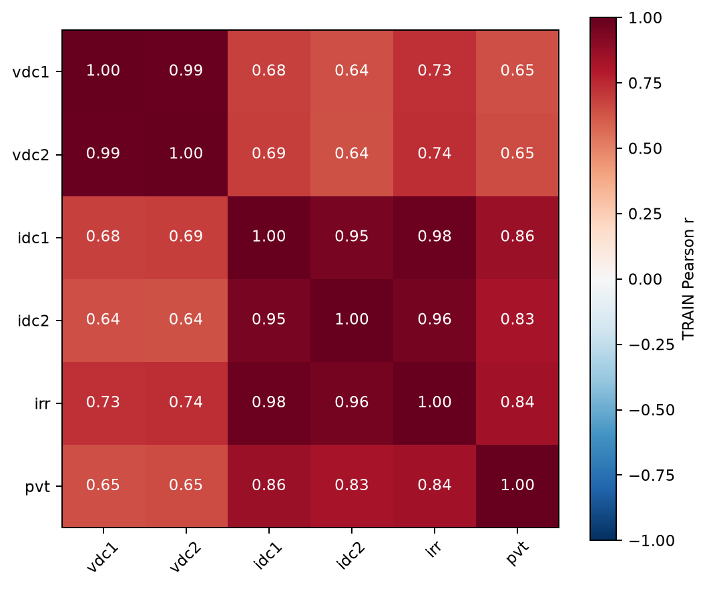
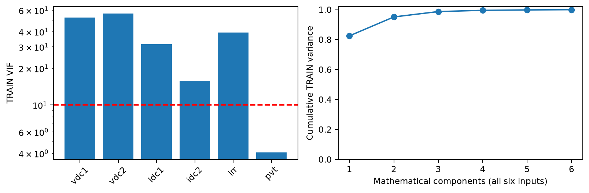
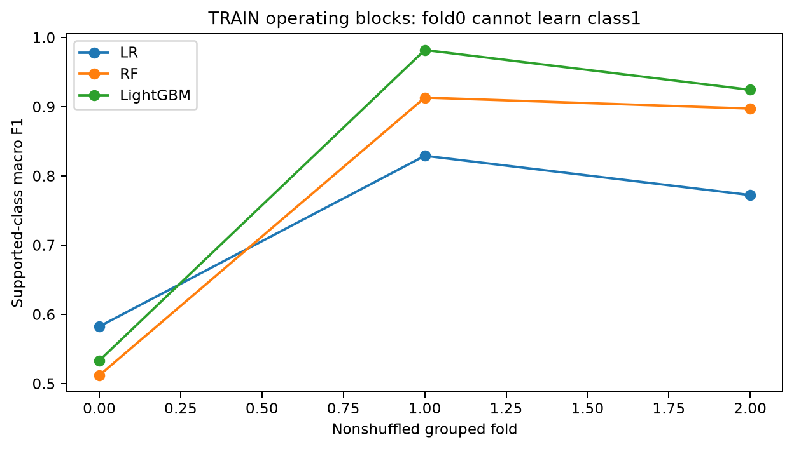
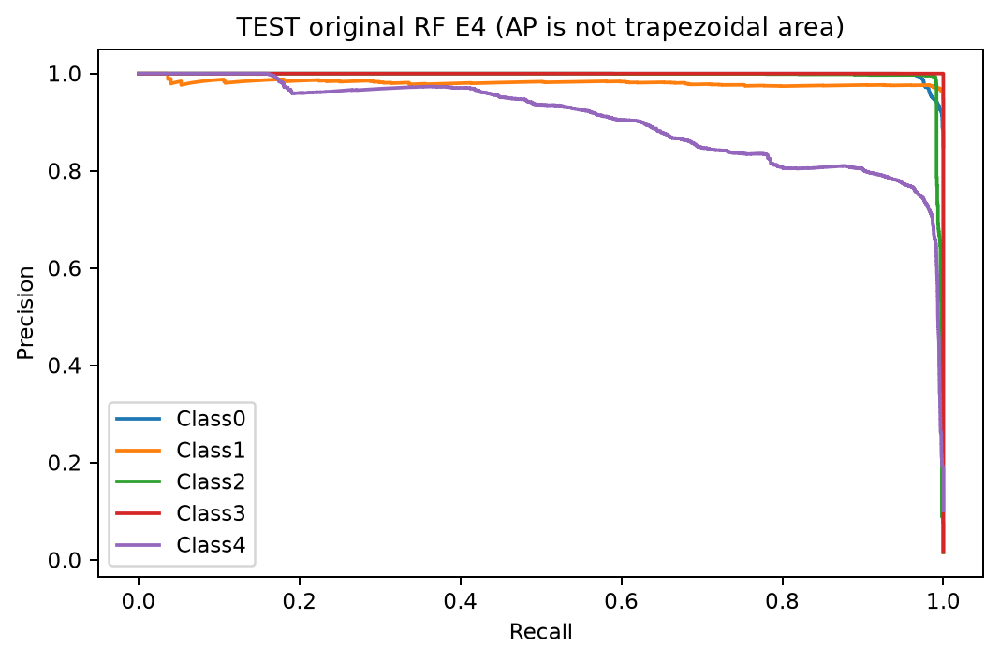
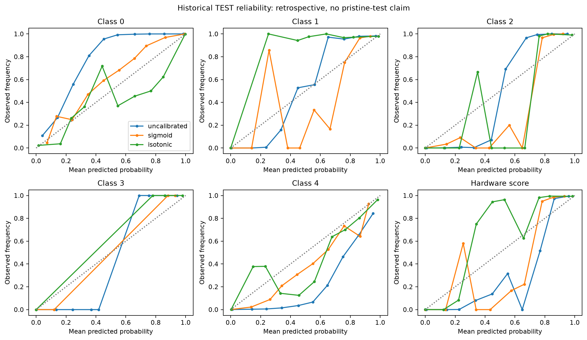
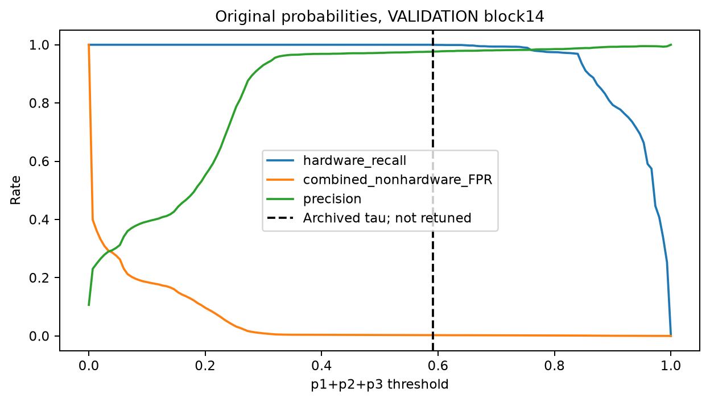
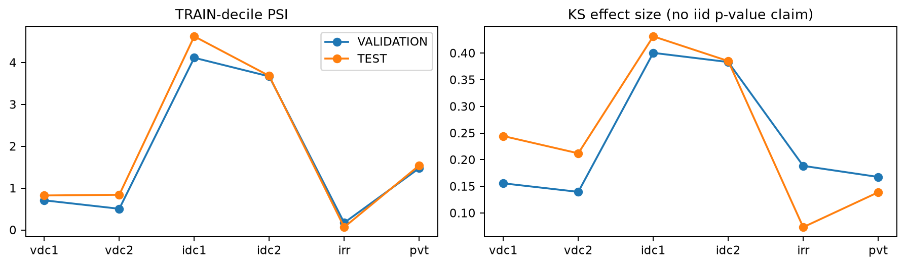
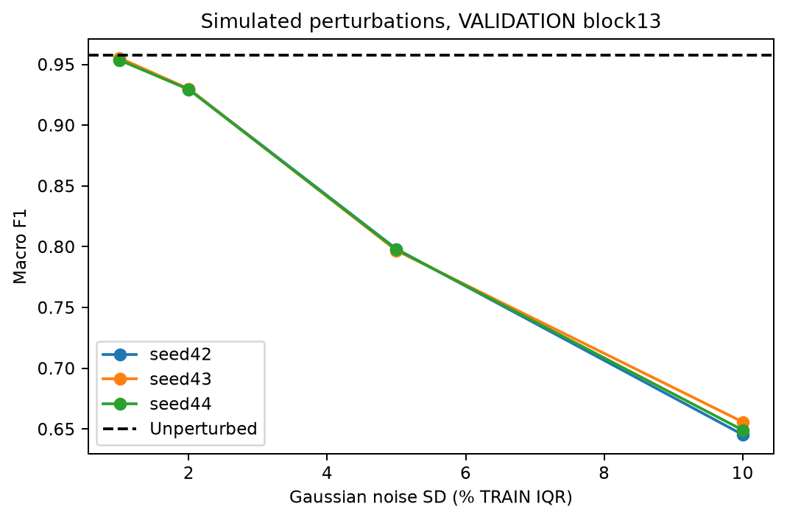

# Final technical evaluation: 04-652 AI System Design

Audit date: 24 November 2026. This is an engineering assessment, not an official course grade.

The original RF E4 model, preprocessing, raw CSV, academic reports, source modules and four-step application are preserved. New fits and calibration maps are separate experimental objects in an ignored cache. Historical TEST was previously inspected; every new TEST analysis is retrospective. No independent external-site validation is available. No model or threshold was selected from the new TEST diagnostics.

## Prediction problem and operational consequences

The prediction unit is one source-position observation, not a verified timestamp or time window. Six continuous exported channels are available offline: vdc1/vdc2 in V, idc1/idc2 in A, irradiance in W/m^2 and module temperature in degrees C. The deployed RF E4 requires exactly the four electrical channels. Its eight mathematical inputs consist of four measurements and four missingness indicators, not eight physical sensors. Derived features require their physical parent channels; PCA is mathematical reduction, not sensor reduction.

The target f_nv is nominal: 0 normal, 1 short circuit, 2 resistive degradation, 3 open circuit, 4 natural building shade. Shade is environmental, not hardware failure. This is an educational single-study inference demonstrator, not a certified protection device. Missing a hardware fault may delay intervention; a false hardware alert may prompt unnecessary inspection. Shade misclassification affects interpretation without making shade a hardware failure. The hypothetical cost matrix varies hardware-miss severity across 2, 5, 10 and 20 relative units; no monetary cost, stakeholder-approved utility or TEST-optimized operating policy is asserted. Source provenance remains linked in the root README and original reports.

## Data hygiene and feature dependencies

The recomputed export has N=1,373,798, P=7, zero NaNs and infinities, zero incomplete rows, and 62 paired irr/pvt zeros. Paired zeros remain observations rather than presumed missing data. Constant zero missingness indicators cannot identify MCAR/MAR/MNAR. Little's MCAR statistic and a missingness-versus-target Cramer's V are not estimable for these constant patterns; no invented statistic or p-value is supplied. Invalid electrical negatives, near-zero irradiance and valid negative Celsius measurements retain the existing quality policy.

TRAIN-only IQR (1.5*IQR fences), absolute Z>3, modified MAD Z>3.5, skewness and a bounded normality diagnostic are recorded. Dependent rows invalidate a naive independent-sample interpretation of normality p-values. Fault extremes are not automatically removed. Pearson and Spearman screening use |r|>=0.85; VIF screening uses >10. TRAIN median imputation, LR standardization, RF native scaling and class weights are verified. MI is descriptive association with a nominal target, not causation. PCA is fitted on TRAIN-standardized six-channel data and remains exploratory.

TRAIN VIF: vdc1=52.168, vdc2=56.346, idc1=31.496, idc2=15.781, irr=39.293, pvt=4.070. High VIF alone does not justify deleting a sensor; physical dependencies, validation ablation, availability and class-specific errors determine retention. No deployed feature was removed.

| Separate RF experiment | Block13 macro-F1 | Changed TRAIN cells | Changed block13 cells |
| --- | ---: | ---: | ---: |
| none | 0.956297122 | 0 | 0 |
| iqr | 0.956297122 | 0 | 0 |
| quantile | 0.956041296 | 39223 | 60 |

No-clipping remains the deployed policy. IQR clipping did not improve validation performance; quantile clipping slightly reduced it. Changed-row counts by class expose whether fault observations were affected. These are new experimental fits, never replacements for original model bytes.

## Split integrity, duplicate vectors and validation

The immutable ordered split is TRAIN [0,1006129), VALIDATION [1056990,1173967), TEST [1227337,1373798), with 104,231 excluded separator positions. Signal-defined operating blocks are not verified days, sessions or hours; timestamps are absent. Group0 denotes outside operating intervals and is not a shared experimental session. Source indices and operating blocks are disjoint. Six-channel and four-channel vector hashes found zero cross-partition exact vector matches and zero conflicting duplicate-label vectors. Matches were designed to require direct numeric equality, rather than relying on hash equality alone. Repeated readings within a partition are not automatically leakage.

Near-duplicate diagnostics are bounded to 100,000 TRAIN references and 5,000 queries per later partition with TRAIN-fitted scaling. This is not exhaustive proof of sample independence. The published preprocessing verifier checks the original TRAIN-only statistical references; new fold ledgers record fit/evaluation index digests, preprocessing medians, scaler means, clipping fit populations and fold-specific weights. Target, acquisition index and block identifiers do not enter inference features.

Three nonshuffled GroupKFold folds use the 12 TRAIN operating blocks only, independently fitting preprocessing and LR/RF/LightGBM. Background rows are excluded from this extra diagnostic, so its scores should not be compared as the same population as the original full-split validation score. Class1 occurs only in TRAIN block12; holding that block out makes class1 unlearnable. Class3 is also concentrated there. Absent true classes have undefined recall/AP rather than fabricated observations. Fixed-five and supported-class aggregates are explicitly distinct.

| Fold | Model | Supported-class macro-F1 | Unseen true labels in fit |
| --- | --- | ---: | --- |
| 0 | LR | 0.582694 | [1] |
| 0 | RF | 0.512135 | [1] |
| 0 | LightGBM | 0.533485 | [1] |
| 1 | LR | 0.829218 | [] |
| 1 | RF | 0.913322 | [] |
| 1 | LightGBM | 0.982118 | [] |
| 2 | LR | 0.772501 | [] |
| 2 | RF | 0.897464 | [] |
| 2 | LightGBM | 0.924577 | [] |

This variation reveals a genuine transfer limitation. It is not used to select a new winner.

## Original model comparison and metric definitions

The 21 original sensor/model artifacts were hash-verified and their block13 macro-F1 reproduced within 1e-12 using the private cache. Only RF E4 is publicly shipped as a model binary. Original LR and LightGBM are PRIVATE-CACHE REPRODUCED, not publicly downloadable original artifacts. Public training scripts reconstruct new models with separate provenance. E4 is the fair four-physical-input comparison; F6 is a six-sensor resource reference. LightGBM additionally computes derived mathematical features, so E4 does not imply equal mathematical dimensionality or model capacity.

VALIDATION block13 originally selected model/settings; block14 selected the archived hardware threshold. TRAIN in-sample predictive scores are deliberately not presented as validation evidence.

| Original model / baseline | Physical channels | Block13 macro-F1 | Historical TEST macro-F1 | TEST hardware AP |
| --- | ---: | ---: | ---: | ---: |
| Dummy_most_frequent | 4 | 0.144269 | 0.183800 | 0.048074 |
| Dummy_prior | 4 | 0.144269 | 0.183800 | 0.048074 |
| original_RF_E4 | 4 | 0.956297 | 0.950481 | 0.993354 |
| LR__F6 | 6 | 0.893870 | 0.898389 | 0.989638 |
| LR__E4 | 4 | 0.588207 | 0.638112 | 0.415942 |
| RF__F6 | 6 | 0.865793 | 0.944190 | 0.993492 |
| LightGBM__E4 | 4 | 0.855657 | 0.902137 | 0.994775 |
| LightGBM__F6 | 6 | 0.856895 | 0.899589 | 0.994492 |

Dummy baselines accept four columns but use no sensor values. Their equal argmax classifications conceal different probability distributions; neither is a subtype detector. A TRAIN-q99 current-imbalance rule is reported separately as a binary reference, not a five-class diagnosis. Its threshold was not optimized on TEST.

Every detailed metric JSON includes class support/base rates, per-class precision/recall/F1/AP, fixed-five and supported-class macro-F1, weighted F1, balanced accuracy over supported classes, macro AP where all five one-vs-rest problems are defined, hardware AP, P@top1%, and full confusion matrices. AP is one-vs-rest average precision, not trapezoidal PR-AUC. Hardware score is p1+p2+p3; shade is excluded. Thresholded hardware alerts and multiclass argmax are separate decisions. Normal/shade FPR denominators are their respective true class populations; combined FPR uses true {0,4}. Hardware recall uses true {1,2,3}; abstentions count as misses. MAE is not meaningful for nominal integer-code distances.

## Calibration, thresholds and uncertainty

The frozen protocol preceded new TEST diagnostics. Class-wise sigmoid and isotonic maps use only block14 base-model probabilities. Four source-tile cross-fitting folds (256 positions/tile, fold=tile mod4) purge64 neighboring positions around held-out tiles. Minimum positive support is50 sigmoid/100 isotonic, with at least100 negatives. One-vs-rest outputs are clipped at1e-12 and normalized across classes. Sigmoid is logistic regression on the original class probability; isotonic is a monotone piecewise mapping. Every fold and class passed support checks. Final maps fit all block14 only after the cross-fitted selection receipt was written.

The method is chosen by cross-fitted log loss, with Brier as tie-breaker, before TEST evaluation. Artificial tiles from one operating block do not create independent sessions. Block14 was historically used for the original uncalibrated threshold; no calibrated threshold was tuned or assessed. These experiments evaluate probability quality, not a new calibrated alert system. No calibrated confidence appears in production.

Brier = mean over observations of sum over five classes (p-y_onehot)^2, range[0,2]. ECE is the weighted absolute gap between mean probability and observed frequency in10 fixed equal-width bins. Top-label, each class and hardware reliability are supplied; ECE depends on binning and prevalence.

| Method | Block14 cross-fitted Brier | Block14 cross-fitted log loss | TEST Brier | TEST log loss | TEST top-label ECE |
| --- | ---: | ---: | ---: | ---: | ---: |
| uncalibrated | 0.136794 | 0.270283 | 0.079293 | 0.151089 | 0.023762 |
| sigmoid | 0.108082 | 0.183745 | 0.051306 | 0.089088 | 0.014281 |
| isotonic | 0.106205 | 0.192525 | 0.053112 | 0.092305 | 0.011333 |

Sigmoid wins the pre-TEST selection criterion. Isotonic has lower ECE but was not selected on that basis or on TEST. Both remain separate experimental alternatives.

The original tau=0.5913558658757772 and its original selection evidence remain unchanged. A151-point descriptive block14 threshold curve is plotted without selecting a new threshold. The original enumeration evaluated every distinct score, unlike this display grid.

The block bootstrap uses the12 RF experimental grouped-OOF confusion matrices, seed42 and500 resamples. 339 retained all five class supports; 161 did not and were excluded under the predeclared conditional rule. Conditional95% percentile ranges: macro-F1 [0.496889822849725, 0.625075645912329], balanced accuracy [0.4685909264310716, 0.5645609088168585]. These are exploratory conditional intervals for this grouped-OOF diagnostic, not confidence bounds for the deployed model's TEST F1. One rare-fault block and dependent signal blocks prevent established population coverage. Two TEST operating blocks do not justify a reliable independent-site CI.

## Error analysis, cohort shift and sensing

Subgroup tables include TRAIN, VALIDATION and TEST separately: irradiance <100/100-400/400-800/>=800 W/m^2, TRAIN-quartile temperature/output/voltage-imbalance/current-imbalance, individual source blocks and all fault classes. Output is vdc1*idc1+vdc2*idc2; imbalance is absolute channel difference divided by the absolute sum plus1e-12. Boundaries are fixed from TRAIN or the stated physical irradiance bands. Support<100 and class support<50 are flagged; absent-class estimates remain undefined.

The original TEST confusion contains6,604 normal-to-shade errors. Shade precision is0.6910808662 despite shade recall0.9911456936. Conditional medians of each sensor for these errors and correctly predicted normal observations are supplied. These differences and cohort shifts are associations, not evidence that any physical mechanism caused the errors.

TRAIN-decile PSI uses epsilon1e-6 and renormalization; KS statistics and Wasserstein distance are descriptive effect sizes. No iid p-value is interpreted. TEST idc1 PSI is4.627 and KS0.431; idc2 PSI3.682 and KS0.385. TRAIN and later partitions differ substantially, including operating/background composition and class prevalence. Call this source-cohort shift, not verified temporal drift.

Archived sensor-ablation metrics, raw-channel permutation, LightGBM native SHAP additivity/mean magnitudes and isolated dropout were reproduced. Additional RF-specific raw-channel permutation uses a fixed balanced block13 sample200/class and three repeats, recomputing the whole downstream pipeline. Balanced-sample importance is not natural-prevalence performance. Importance is predictive, not causal; correlated channels redistribute attribution. Four retained electrical channels are a minimum only under the evaluated archived alternatives and stated rule, not a globally proven minimum.

## Simulated stress and synthetic presets

The stress sample contains12,000 fixed natural-prevalence block13 positions, seed42. Noise SD is1/2/5/10% of each channel's TRAIN IQR, seeds42/43/44, with nonnegative constraints. Bias is +/-5/10% TRAIN IQR applied to all four channels. Saturation fixes one channel to TRAIN q05/q95; finite OOD uses TRAIN maximum+IQR. All are simulated interventions, not measured field failures. Their original labels are retained as stress references; extreme interventions may violate real photovoltaic relationships, so label preservation is itself an assumption.

Unperturbed stress-sample macro-F1: 0.957857.

| Noise SD (% TRAIN IQR) | Macro-F1 range across three seeds |
| --- | --- |
| 1% | 0.953612-0.955347 |
| 2% | 0.929383-0.929881 |
| 5% | 0.796863-0.798149 |
| 10% | 0.645450-0.655924 |

At-10% additive bias macro-F1 falls to0.507349. Persistent channel failures are unsafe: the sparse12,000-position sample has gaps that reset missing-run eligibility, yielding86.42% eligible predictions when one entire sampled channel is unavailable. This is NOT uninterrupted outage tolerance. A separately frozen supplemental check on all32,800 contiguous block13 positions leaves only the first two positions eligible (coverage0.0000609756), after which the existing >2-position rule abstains. Two simultaneous missing channels yield zero coverage. The API rejects missing inputs instead of invoking this offline imputation policy.

All five illustrative synthetic presets still predict shade; four intended labels differ. The generator remains unchanged. TRAIN-only class-channel quantiles and standardized nearest neighbors from100,000 TRAIN references show that intuitive marginal signatures do not establish valid joint photovoltaic operating states. A range check alone cannot validate a synthetic class label. Historical source observations remain a separate demonstration mode. Neither TEST tuning nor iterative desired-label preset search was performed.

## Reproducibility, cloud, security and container status

A fresh no-hardlinks clone and separate newly installed pinned Python3.14.10 environment executed the13-cell preprocessing notebook without classifier training, original RF recovery/parity checks,7 new tests,6 original inference tests and10 API tests. The original notebook/report bytes in the active repository were not regenerated. A real localhost uvicorn process served health, HTML and five inference examples. This verifies installation and execution, not byte-identical regenerated notebook timestamps or cross-platform trained-model binaries. The existing web test dependency emits a nonfatal deprecation warning.

Live anonymous health reports the exact original model SHA. Live predictions match five original CLI references. Missing/extra/negative/nonfinite/null/string/oversized payloads are rejected. Browser smoke passes desktop1366/1920, tablet820 and mobile390/320 widths, four-step state preservation, keyboard/reduced-motion navigation and error handling. No UI source or deployed confidence semantics changed.

The20-request sequential persistent-client benchmark succeeded20/20: first 349.59ms, min 349.59ms, max 456.68ms, mean 375.41ms, p50 362.75ms, p95 413.86ms, p99 448.11ms. Subsequent19-request p95 416.11ms. Client timezone is Africa/Johannesburg; physical network egress was not geolocated. These are network round trips, not server-model timing or confirmed cold starts. Health/parity calls preceded the benchmark. The original local RF p95=36.808295ms still exceeds the10ms engineering target; artifact size11.665MiB still exceeds10MiB. Neither target was weakened.

Authenticated Vercel metadata confirms Hobby and the existing project. Official pricing was checked24 November2026:4 CPU-hours,360 GB-hours and1 million invocations per period. The hypothetical40ms CPU/0.2s in-flight/1GB scenario uses0.0111 CPU-hours at1,000 requests,1.111 at100,000,11.111 at1 million. Thus1 million exceeds the CPU allowance despite staying within the invocation count. These durations are assumptions, not deductions from network timing. Actual invoice/charge evidence was unavailable. Hobby quota exhaustion can pause service; no paid upgrade or purchase occurred. Optional Cape Town Pro gross-resource arithmetic is illustrative and excludes subscription, credits, taxes and transfer, not a quotation for this Hobby deployment.

The dependency advisory check found no known vulnerabilities among41 pinned audit-environment distributions at execution time. Advisory absence is not a guarantee; the deployed environment was not upgraded. The heuristic Git-history scan checks strong secret signatures and environment-file candidates without printing secrets. The full scope/counts are in the security receipt. Model deserialization accepts only the fixed trusted hash-checked artifact; no arbitrary pickle upload exists. Input bodies are capped at2,048bytes and schema/nonfinite/duplicate fields rejected. Per-user application rate limiting is absent; public quota exhaustion remains a risk.

The new root Dockerfile uses Python3.14.10, pinned inference requirements, a nonroot account and the original model. Dockerfile creation is VERIFIED; image build/run is NOT VERIFIED because Docker/ Docker Desktop are unavailable. Linux wheel/runtime compatibility remains untested. No production-readiness, safety certification, monitoring system, independently calibrated deployed confidence or cold-start guarantee is claimed.

## Evidence and assessment

See [requirement matrix](Rubric_Compliance_Matrix.md), [reproduction guide](Reproduction_Guide.md), [limitations](Limitations_and_Risks.md), [initial matrix](Initial_Rubric_Compliance_Matrix.md) and [protected hashes](Protected_Baseline.json). Machine-readable evidence is divided into rubric1-5 folders. `python -B -m technical_evaluation.audit` recomputes confusion-derived F1, verifies protected hashes/protocol/splits/CLI examples/links and runs23 tests. It does not silently retrain or spend cloud requests. Expensive flags are explicit.

| Rubric | Initial /20 | Final /20 | Remaining deduction |
| --- | ---: | ---: | --- |
| Data hygiene, features and collinearity |16|18|Single-study plausibility limits; no field-validated costs/cleaning intervention.|
| Split integrity and leakage-free pipeline |15|17|No independent-site TEST; rare class concentrated in one TRAIN block; bounded near-duplicate screen.|
| Modeling strategy and rigor |14|18|Calibration cross-fitting is within one historical block; conditional uncertainty lacks independent coverage.|
| Error analysis and robustness |15|18|Simulated perturbations and single source; persistent dropout and synthetic mismatch remain limitations.|
| Reproducibility and deployment |16|17|Docker unexecuted, cold starts/billed CPU unmeasured, no per-user operational rate limit.|
| **Total** |**76/100**|**88/100**|Conservative engineering self-assessment, not an official professor score.|

## References

Original dataset/study and original methodological citations remain unchanged in the academic reports. Additional implementation references: [scikit-learn calibration](https://scikit-learn.org/stable/modules/calibration.html), [GroupKFold](https://scikit-learn.org/stable/modules/generated/sklearn.model_selection.GroupKFold.html), [Vercel Hobby](https://vercel.com/docs/plans/hobby), [Vercel compute pricing](https://vercel.com/docs/functions/usage-and-pricing). These sources describe methods and current pricing; project performance comes from the executed local/cloud evidence.
