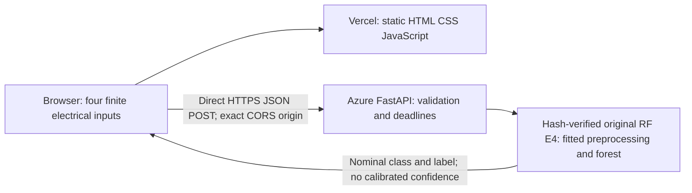

# Technical examination — five-minute demonstration, no slides

## Five-minute sequence

| Time | Action | Evidence to show |
| --- | --- | --- |
| 0:00–0:40 | Open the [production frontend](https://pv-anomaly-detection-prince-r-k.vercel.app) and [Azure API page](https://pv-anomaly-detection.wittygrass-37610045.francecentral.azurecontainerapps.io); wait for Model ready | Explain Vercel static assets versus Azure originalRF. Cold readiness can take about a minute; no artificial keepalive |
| 0:40–1:30 | Navigate all four steps and run one predetermined historical case | Browser Network tab must show POST directly to Azure `/api/predict`, original modelSHA and actual returned label |
| 1:30–2:10 | Show the five-case parity receipt or run the bounded CLI/API command below | Five labels0–4, explicitly identifying4 as environmental shade; parity is not independent accuracy |
| 2:10–3:10 | Show the [split and fitting walkthrough](Final_Rubric_Audit.md#rubric-2--leakage-walkthrough) and same-E4 validation table | No target/index predictors; TRAIN fitting;block13selection;block14threshold/calibration;exposedTEST |
| 3:10–4:10 | Show per-class shade errors, stress and timing/size limits | 6604normal→shade;simulatednoise/dropout;server versus network;10ms/10MiB not met |
| 4:10–5:00 | Show fresh verification and limits |50tests,588protectedfiles,currentCORS, boundedsecretreview; independent score91, not a guaranteed grade |

Do not start model reconstruction, retraining, notebook regeneration, cloud builds or configuration changes during the examination. If startup exceeds the bounded allowance or the service fails, use the offline fallback rather than repeated speculative deployment attempts.

## Exact essential commands

Installation and anonymous clone commands are in the [entry README](README.md#essential-reproduction). From the repository root, using that environment:

```powershell
.\.venv\Scripts\python.exe -B -m technical_evaluation.final_maximization.verify --tests
.\.venv\Scripts\python.exe -B -m technical_evaluation.defense.run_demo
.\.venv\Scripts\python.exe -B -m technical_evaluation.defense.run_demo --url https://pv-anomaly-detection.wittygrass-37610045.francecentral.azurecontainerapps.io
.\.venv\Scripts\python.exe -B -m technical_evaluation.final_maximization.verify --live
```

The first command is local and does not regenerate tracked receipts. The second is fully offline after dependency installation. The third makes five live predictions plus health/invalid-input checks. The fourth independently checks schema/hashes/medians/stored metrics plus bounded public health/CORS/predictions/static hashes. Git must be on PATH for the existing container-context tests. On Linux/macOS use `.venv/bin/python`. Run only one live command if time is limited; repeated live requests are unnecessary.

Optional local HTTP fallback, without cloud credentials:

```powershell
.\.venv\Scripts\python.exe -m uvicorn web.azure_app:app --host 127.0.0.1 --port 8000
```

In a second terminal:

```powershell
.\.venv\Scripts\python.exe -B -m technical_evaluation.defense.run_demo --url http://127.0.0.1:8000
```

No TEST labels are passed to inference. Loopback defaults keep the service local. The current essential clean-clone execution is recorded in [Verification Results](Verification_Results.json); earlier full notebook/Linux executions are historical evidence, not silently rerun claims.

## Direct rubric evidence

1. [Data hygiene / collinearity](Final_Rubric_Audit.md#rubric-1--data-hygiene-features-and-collinearity), [TRAIN screening](../evidence/rubric1/feature_screening.json).
2. [Leakage map](Final_Rubric_Audit.md#rubric-2--leakage-walkthrough), [fold ledger](../evidence/rubric2/grouped_validation.json).
3. [Model evaluation](Final_Rubric_Audit.md#rubric-3--modeling-and-evaluation), [fixed comparison](../evidence/rubric3/model_comparison.json), [current reproduction](Metric_Reproduction.json).
4. [Failure modes](Final_Rubric_Audit.md#rubric-4--engineering-failure-modes), [subgroups](../evidence/rubric4/subgroups.json), [stress](../evidence/rubric4/stress.json).
5. [Reproducibility/cloud](Final_Rubric_Audit.md#rubric-5--current-reproducibility-and-serving-evidence), [live HTTP](Live_Verification.json), [real browser](Browser_Verification.json), [current configuration](Cloud_Configuration.json).

## Five fixed historical reference inputs

Original immutable cases: [inputs and complete outputs](../../deployment/example_cases.json). Values preserve the published units V,V,A,A and original order.

| Class | vdc1 | vdc2 | idc1 | idc2 | Expected label |
| --- | ---: | ---: | ---: | ---: | --- |
|0|300.031|329.544|.2247|.1272|normal|
|1|256.461|208.699|9.1373|8.4463|short circuit|
|2|259.212|246.611|9.0792|8.3303|resistive degradation|
|3|262.91|.8866|8.9742|.0468|open circuit|
|4|334.823|335.877|.4303|.2274|natural building shade|

These cases were fixed historically from TEST for deployment parity; no source-position field or true target is required by the API. Five matched examples do not estimate generalization accuracy or guarantee a label for arbitrary synthetic inputs.

## Serving architecture



Vercel serves nine output files including configuration, zero models/Python/inference functions. Azure alone loads the fixed12,232,020-byte model in Consumption0.5vCPU/1GiB,min0/max1. The original pipeline has four physical sensors and eight mathematical features. The model, dataset and scientific evidence remain preserved. [Asset manifest](../../docs/final-release/Frontend_Manifest.json), [browser destinations](Browser_Verification.json), [current resource settings](Cloud_Configuration.json).

## Ten difficult questions and evidence-backed answers

1. **Why report missingness tests as N/A?** All exported NaN indicators are zero. Little's test has no incomplete patterns; missingness Cramér V has a zero category-dimension denominator. This cannot identify MCAR/MAR/MNAR, and62pairedzeros remain observations. [Missingness evidence](../evidence/rubric1/missingness.json).

2. **Why retain highly correlated channels?** TRAINvoltagePearson=.9891 andVIFs>10 flag redundancy, but redundancy does not prove a sensor is dispensable for faults. RF E4 alone meets the four declared validation constraints among21evaluated configurations. PCA requires physical parent channels and cannot establish reduced sensing. [Screening](../evidence/rubric1/feature_screening.json), [ablation](../../phase2_implementation/stage2/evidence/sensor_ablation_validation.csv).

3. **Is the TEST set truly independent?** No such claim is supportable. Source positions, signal blocks and exact feature hashes are disjoint, but TEST was historically inspected; near physical states are common and timestamps/sites are absent. A fresh independent cohort is required. No new TEST-guided model selection occurred. [Leakage evidence](../evidence/rubric2/leakage.json), [complete near-neighbor audit](../refinement/results/full_near_duplicates.json).

4. **Where are fitted preprocessing and class weights isolated?** Original medians match TRAIN. Grouped experiments build the full quality/clip/ColumnTransformer/model pipeline per fit fold and derive weights from that fold's y. Calibration fits separateblock14tiles with64-position purges. The rare class is absent from some fold-training supports and is not fabricated. [Source](../experiments.py), [fit ledgers](../evidence/rubric2/grouped_validation.json), [new medians](Verification_Results.json).

5. **Why RF rather than the highest AP model?** With identical E4 inputs, block13F1 isRF.956297 versusLR.588207 andLightGBM.855657. RF satisfies hardware-recall/sparsity/degradation constraints; LightGBM's higher AP does not guarantee argmax subtype recall. RF remains the original validation-selected configuration, not a TEST-selected replacement. [Selection source](../../src/phase2_stage2/selection.py), [comparison](../evidence/rubric3/model_comparison.json).

6. **Are thresholds and confidence calibrated in the application?** No. Production uses original multiclass argmax; hardware class means1/2/3. Tau=.5913558658757772 belongs to a historical sum-of-probabilities alert experiment selected onblock14, and sigmoid/isotonic maps are separate experiments. No calibrated confidence is displayed. [API source](../../web/app.py), [calibration protocol](../refinement/results/calibration/calibration_selection_freeze.json).

7. **How strong are the confidence intervals and exact metric reproduction?** Grouped-OOF bootstrap draws are conditional on one study; only671/1000includeallfiveclasses, and coverage is not guaranteed for independent populations. Current confusions/F1 match, but exact hardwareAP differs at≈10⁻⁷ from machine-precision probability summation/rank effects. The original1e-12test remains failed for that metric. [Bootstrap](../refinement/results/bootstrap_sensitivity.json), [AP diagnostic](AP_Numerical_Diagnostic.json).

8. **What is the largest practical model failure?** Normal→shade confusion produces6604errors andshadeprecision≈.6911. Simulated retained-channel dropout can nearly eliminate valid diagnosis. Shade is environmental, not hardware. Missing inputs are rejected; finite corrupt/OOD inputs remain a risk. [Errors](../evidence/rubric4/normal_shade_errors.json), [contiguous dropout](../evidence/rubric4/contiguous_dropout.json).

9. **Does explainability establish physical causality?** No. TRAINMI is descriptive association; RF permutation is model-specific predictive sensitivity; nativeLightGBM SHAP is for another model, not a liveRFexplanation. Correlated sensors and balanced sampling constrain interpretation. [RF permutation](../evidence/rubric4/RF_raw_channel_permutation.json), [SHAP verification](../evidence/rubric4/archived_explanations_reverification.json).

10. **Were resource targets, free hosting and production readiness achieved?** The frozen model is11.665MiB>10MiB and complete-path10ms remains unmet. Forest-only timing is not the full path; network and cold startup are separate. Azure estimates depend on shared grants; no verified invoice or remaining-credit balance exists. Public serving works, but there is no safety certification, distributed limiter or uptimeSLA. [Costs](../../deployment/azure/Cost_Analysis.md), [live timing](Live_Verification.json), [current limits](Cloud_Configuration.json).

## One-page limitations and offline fallback

| Limitation | Consequence / defensible statement |
| --- | --- |
| No released timestamps/sites/session IDs | Signal blocks are source-position regimes;3,600positions is not a verified hour |
| Historical TEST exposure and near neighbors | Retrospective performance, not pristine independent generalization |
| One rare-fault TRAIN block and one calibration block | Absent-class folds and limited calibration independence |
| Grouped bootstrap conventions | Sensitivity intervals, not established population coverage |
| Exact hardwareAP numerical discrepancy | Original values unchanged; rank-score reproducibility partial |
| Simulated stress and hypothetical costs | No field-failure rate, monetary utility or causal evidence |
| Dropout/OOD | Required inputs cannot be safely assumed recoverable; warnings are not safety abstention |
| Size / full-path latency | Original10MiB/10ms targets unmet |
| Scale-to-zero and anonymous service | Startup can approach a minute; no uptime promise/distributed rate limiter |
| Billing/security/accessibility | Estimates/heuristic scans/automated checks are bounded evidence, not certifications |

If cloud readiness is delayed, show the status and existing receipt, then run the **offline** five-case command. The local model is the same hash-verified artifact; no predictions are fabricated and no cloud fallback is silently claimed. An internet-free examination requires dependencies already installed or a prebuilt verified container already available; a fresh download cannot be promised offline. Keep the [current browser receipt](Browser_Verification.json), [Linux evidence](../../docs/azure-backend-identity/deployment/README.md) and [final release screenshots](../../docs/final-release/README.md) available locally. No rollback, redeployment or model reconstruction is needed to explain the submission.
